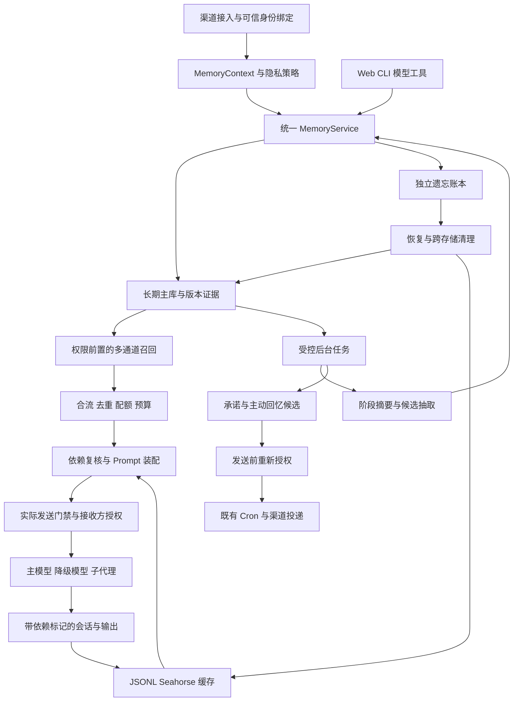

# PicoClaw 伴侣记忆系统 V4 实施计划

> 从“可存储、可检索”升级为“可信、可治理、可理解、可控主动”的长期记忆系统。

| 项目 | 说明 |
|---|---|
| 文档版本 | V4.3，核心方案已在 **v0.7.0** 实施；本稿保留完整设计契约与未实施项 |
| 编制日期 | 2026-11-21 |
| 实现基线 | PicoClaw **0.7.0**，Git HEAD **`7287e6d6`**（v4 实施提交在其后） |
| 数据库基线 | `memstore.CurrentSchemaVersion = 4`（只保留 v3 → v4 单段迁移） |
| 上游方案 | `/home/zemi/文档/PicoClaw-伴侣记忆系统设计文档.md`，合并 V1—V3 的完整方案，原对应 0.5.10 |
| 本次交付 | V4.3 记录 0.7.0 已实施范围、实施差异与剩余可选项；迁移说明见 `docs/reference/memory-schema-v4.md` |
| 状态约定 | “现状”来自 0.7.0 代码核查；“拟新增”“目标”“应”均指尚未实施内容，不代表已经上线 |
| 版本约定 | **方案 V4 不等于软件 v0.4**。发布于 v0.7.0，Schema 只有一个 v4 |

---

## 实施状态（v0.7.0，2026-11-21）

**已实施（A 段为主，B/C 段基础设施）：**

- **M4/Schema v4**：`v3 → v4` 单段迁移；旧 `v1/v2/v3` 迁移链按要求删除；v1/v2 库拒绝并要求先用 0.6.x。迁移逐字段保留 `sources` 证据，缺失对象自愈。
- **域与身份**：`memory_domains`、`memory_actor_bindings`、`memory_processing_grants`、`MemoryContext`、`VisibilityFor`、工具真实渠道上下文（B01）。
- **域内去重**（FR-03/B03）：唯一索引与所有合并路径按 `domain_id` 隔离。
- **治理入口**：`MemoryService`、变更计划 + 审批（CAS revision 冲突）、`pinned_core` 保护、`PUT /entries/{id}` 正文变化转 `Correct`（B02）。
- **遗忘闭环**（G2）：独立 `forget-ledger.db`（journal-first、HMAC、目标清单）、`Forget` 联动关系状态与历史（B06）、`ReplayForget` 跨备份重放、账本健康检查。
- **检索修复**（G3）：权限前置 SQL（B07）、长查询 LIKE 回退（B09）、纯时间命中（B08）、1-Hop 去重与配额（B10）、预算与分隔符记账（B11）、TTL 统一过滤。
- **Web/API**：inspect / correct / forget / domains / ledger / clusters / summaries / commitments / recalls / jobs / plans（§13.2 的核心子集）。
- **B 段**：手工主题/阶段簇、规则摘要器、逐 claim 证据、generation 失效（G5 基础设施）。
- **C 段**：承诺生命周期、回忆候选/反馈、投递状态（G6 基础设施，主动发送默认关闭）。
- **任务与配置**：持久任务队列（租约/重试/阻塞）、V4 配置开关默认关闭（G7/G8）。
- **测试**：v3→v4 迁移、跨域去重、账本重放、关系状态联动、计划 CAS、摘要证据/失效、承诺状态机、任务重试、群聊可见性、敏感分类、TTL 过滤。

**尚未实施（诚实边界）：**

- 主聊天/fallback/子代理的**实际发送点许可门禁**（§10.7 的完整时序；当前只有工具读取门禁与处理许可表）。
- 外部 LLM 抽取、embedding/向量检索、MMR（G7/G8）：只有配置开关与禁用默认，没有 Provider 接线。
- 跨存储清理执行器：JSONL/Seahorse 的逐消息清理接口与任务消费尚未实现，`forget` 目前完成主库 + 关系状态 + 摘要失效，账本保留其余清理义务供后续 replay。
- 前端完整工作台 UI：API 客户端已接线，页面组件仍只覆盖 0.6.0 的列表/审核/关系/设置/迁移。
- 计划审批的独立登录二次确认、演示模拟器、性能 SLO 实测。

**实施差异（与本文档原设计的偏差）：**

- 迁移合并为**单段 v4**（原 M4/M5/M6 三段），所有表在同一次 `v3 → v4` 中创建；用户明确要求“迁移只保留 v3 到 v4”。
- `relationship_state` 保留 `key` 主键并新增 `domain_id` 列，未改为复合主键（兼容现有 Web/CLI 调用；域过滤在查询层完成）。
- 精确去重索引采用 `(domain_id, content_hash)`，未包含 `subject/predicate/facet/qualifiers_hash` 全组合；结构化语义仍由模板键与自动替换路径区分。
- `Forget` 对未标记来源的关系状态按 predicate 映射清理（`nickname → user_name/ai_name` 等），避免要求历史数据先补齐来源标记。

---

## Goal：V4 总体目标

以 **PicoClaw 0.6.0 当前代码**为实现基线，合并完整 V1—V3 设计、此前分析提出的修补方案与新增功能建议，形成一份**可分阶段执行、可验收、可迁移、可恢复的 V4 伴侣记忆系统实施计划**，而不是沿用旧版本的完成情况或重新建设已有能力。

### 产品与工程目标

1. **记得可信**：记忆有来源、有版本、有明确时态；区分用户事实、模型推断、角色扮演、临时情绪和未来计划，不把猜测当成已确认事实。
2. **用得安全**：Web、API、CLI、模型工具、自动抽取、固定注入、检索、摘要与主动消息统一执行身份、权限域、受众和隐私策略，避免跨用户、跨渠道及真实/虚构内容串用。
3. **用户可控**：支持暂停采集、限制使用、敏感信息授权、审核、纠错、冲突澄清和遗忘；让用户看见“记住了什么、为什么记住、为什么提起、删除到了哪里”。
4. **忘得可靠**：建立跨条目、关系状态、历史派生正文、来源会话、摘要、索引与后台任务的分范围清理和恢复机制；在已声明的账本与灾备边界内，阻止已遗忘内容因旧任务或旧备份重新出现。
5. **理解长期关系但不越界**：在可信底座之上增加主题与阶段摘要、共同经历时间线、结构化承诺、纪念日及默认关闭的主动回忆，不自动推断亲密度、不制造情感依赖。
6. **保持轻量且可验证**：复用现有 Go、SQLite、React、Seahorse、Cron 和配置重载能力；先完成正确性与治理，再按实测收益决定是否启用 LLM 抽取、向量检索与 MMR。每阶段明确需求、任务、依赖、代码落点、验收证据和迁移/回滚条件。

### 本次交付目标与边界

本次交付是上述目标对应的**完整实施计划评审稿**：明确当前已实现能力、待修补缺口、拟新增功能、实施顺序及发布门禁。**仅分析并维护本文档，不实施功能、不修改业务代码或运行配置、不操作真实记忆数据库，也不将计划中的能力表述为已完成。**

---

## 目录

- [Goal：V4 总体目标](#goalv4-总体目标)

1. [执行摘要与实施边界](#1-执行摘要与实施边界)
2. [0.6.0 能力基线与缺口](#2-060-能力基线与缺口)
3. [V4 功能范围与需求清单](#3-v4-功能范围与需求清单)
4. [目标架构与不可破坏的不变量](#4-目标架构与不可破坏的不变量)
5. [身份、权限与隐私控制](#5-身份权限与隐私控制)
6. [统一写入、审核、纠错和版本生命周期](#6-统一写入审核纠错和版本生命周期)
7. [数据模型与分段迁移](#7-数据模型与分段迁移)
8. [遗忘、跨存储清理与恢复闭环](#8-遗忘跨存储清理与恢复闭环)
9. [证据绑定、抽取流水线与记忆回执](#9-证据绑定抽取流水线与记忆回执)
10. [召回、时间语义、预算与解释](#10-召回时间语义预算与解释)
11. [主题聚类、阶段摘要与共同经历](#11-主题聚类阶段摘要与共同经历)
12. [承诺、纪念日与可控主动回忆](#12-承诺纪念日与可控主动回忆)
13. [Web、API、CLI 与模型工具](#13-webapicli-与模型工具)
14. [配置、生效机制与运维观测](#14-配置生效机制与运维观测)
15. [分阶段实施与任务拆解](#15-分阶段实施与任务拆解)
16. [迁移、灰度、恢复与回滚操作规程](#16-迁移灰度恢复与回滚操作规程)
17. [验证计划、评测集与发布门禁](#17-验证计划评测集与发布门禁)
18. [非功能要求与性能测量](#18-非功能要求与性能测量)
19. [关键决策、风险与待确认事项](#19-关键决策风险与待确认事项)
20. [最终交付清单与方案映射](#20-最终交付清单与方案映射)
21. [完整文档审查与推荐补充记录](#21-完整文档审查与推荐补充记录)

---

## 1. 执行摘要与实施边界

### 1.1 总体判断

0.6.0 已有 V3 的主要存储与治理底座，不应重复建设 CRUD、persona 版本、FTS、关系边、胶囊或迁移系统。0.6.0 的主要新增是全局系统提示词，长期记忆核心仍沿用 V3。

V4 首先解决四个问题：

1. **权限一致**：固定注入、搜索、inspect、胶囊、工具、摘要与主动消息使用同一套权限上下文。
2. **治理一致**：Web 保存、模型工具、CLI、导入、抽取、修复和清理不能绕开版本、证据、核心保护与遗忘规则。
3. **遗忘可信**：删除条目后，关系状态、历史派生正文、排队任务、摘要和恢复备份不能使内容重新出现。
4. **结果可解释**：用户能知道“记住了什么、依据是什么、为什么被召回、修改了什么、删除到哪一层”。

随后再实现：

- 证据约束的主题聚类、阶段摘要和共同经历时间线。
- 结构化承诺、纪念日及默认关闭的主动回忆。
- 可选 LLM 抽取、语义召回与 MMR；只有证明收益后才放量。

### 1.2 三段交付

| 交付段 | 包含阶段 | 用户获得的能力 | 放行条件 |
|---|---|---|---|
| A：可信记忆底座 | G0—G4 | 安全读写、完整纠错与遗忘、可视化管理、可靠检索 | 权限、恢复、迁移和跨入口治理门禁全部通过 |
| B：长期理解 | G5 | 共同经历、阶段摘要、L1 摘要与 L2 证据展开 | 摘要可追证、可失效、可重建，删除竞态测试通过 |
| C：可控主动 | G6 | 承诺跟进、纪念日、用户授权的主动回忆 | 发送前重检、限频、静默时段和关闭开关有效 |
| 可选增强 | G7、G8 | LLM 结构化抽取、向量/MMR | 独立开关、成本上限、盲测收益及可撤回发布 |

A 可以先发布，B、C 不得成为 A 的上线前置。安全修补不依赖云端模型、向量扩展或新前端测试框架。

### 1.3 明确不做

- 不把短期情绪自动固化成人格或真实长期事实。
- 不根据聊天次数自动增长“亲密度”，不以主动回忆制造依赖或施压。
- 不把 `use_count` 直接加入相关性评分，避免自强化反馈环。
- 不自动改写全局 `SOUL.md`，不把私密伴侣 persona 写进全渠道系统提示词。
- 不将“曾经说过”无条件视为“现在仍然有效”。
- 不默认上传历史聊天到外部摘要、抽取或 embedding 服务。
- 不承诺精确一次跨平台投递、物理介质彻底擦除、撤回已经发送给第三方的内容。
- 不在首期建设跨设备同步、通用知识图谱平台、独立向量数据库或通用工作流引擎。

## 2. 0.6.0 能力基线与缺口

### 2.1 需要保留并复用的能力

下列路径均相对仓库根目录；行号对应本次基线，后续可能漂移。

| 能力 | 当前状态 | 代码落点 | V4 处理 |
|---|---|---|---|
| SQLite 长期记忆、WAL、Schema 迁移 | 已有 | `pkg/memstore/store.go`、`migrate.go` | 演进，不重建存储引擎 |
| facet、受控 predicate、冲突与去重 | 已有 | `predicate.go`、`dedupe.go`、`store.go` | 增加权限域边界与一致写入口 |
| persona 版本、渠道选择 | 已有 | `pkg/memstore/relationship.go` | 补作用域贯通、历史查看和恢复为新版本 |
| relationship 历史与 TTL | 已有 | `pkg/memstore/relationship.go` | 补来源依赖、作用域、TTL 三态编辑 |
| 证据字段、确认、版本化纠错 | 已有底层方法 | `pkg/memstore/governance.go` | 补消息身份和所有入口的一致语义 |
| Forget、墓碑、ReplayForget | 已有底层方法 | `pkg/memstore/governance.go` | 补独立账本、恢复门禁、关系状态与跨存储清理 |
| 混合检索、1-Hop、胶囊 | 已有 | `retrieve.go`、`fts.go`、`relation.go` | 修正候选过滤、时间命中、配额与预算 |
| Web 列表、编辑、审核、迁移、修复 | 已有部分闭环 | `web/backend/api/memory.go`、`web/frontend/src/components/memory/memory-page.tsx` | 接通真正的治理和解释能力 |
| 请求级工具上下文 | 已有 | `pkg/tools/shared/base.go:55-151` | 复用 channel、chat、message、agent、session scope，补可信 actor |
| 统一渠道身份工具 | 已有 | `pkg/identity/identity.go` | 复用 canonical ID，不另造一套渠道 ID 解析 |
| 结构化 session scope | 已有 | `pkg/session/scope.go`、`jsonl_backend.go` | 复用其维度，另行判定记忆授权，不能直接当所有权证明 |
| Seahorse 消息、摘要 DAG、FTS | 已有 | `pkg/seahorse` | 复用来源定位和摘要依赖；不混淆会话摘要与长期阶段摘要 |
| Cron、Heartbeat、配置重载通道 | 已有 | `pkg/cron/service.go`、`pkg/gateway/gateway.go` | 复用调度和重载，不重建基础设施 |
| 阶段摘要、主动回忆、LLM 抽取、向量/MMR | 0.7.0 已建基础设施 | `pkg/memstore/summary.go`、`commitment.go`、`jobs.go`；`ExtractModel` 仍仅配置传递 | 摘要/承诺/回忆有表与服务，主动投递与 LLM 抽取、向量/MMR 仍默认关闭 |

### 2.2 本次核查发现的待修补事项

这些是静态代码路径发现，不等于已经在真实部署中观察到泄漏或数据损坏。

| 编号 | 缺口及触发条件 | 当前证据 | 对应阶段 |
|---|---|---|---|
| B01 | 模型搜索走管理检索；胶囊选择配置中的私密渠道，而非真实调用渠道。向公开或群聊开放工具时存在越权路径 | `pkg/tools/memory.go:206-209,323-327`；注册在 `pkg/agent/instance.go:156-158` | G1 |
| B02 | Web 正文修改走 `Store.Update` 原地覆盖，不经过 Correct 的版本与 pinned 检查；确认、审核、归档各走不同路径 | `web/backend/api/memory.go:154-171`；`pkg/memstore/store.go:735-859,924-940` | G1、G4 |
| B03 | 精确指纹唯一索引（`ux_entries_hash`）仅限定 `status='active'`、不含权限域，且精确去重查询不限定状态与域；模板/近重和自动替换未完整包含权限域，可能合并不同 scope/audience/realm 的写入 | `pkg/memstore/store.go:68,330-411,566-597` | G1 |
| B04 | 来源唯一键不区分同一会话中的不同消息；消息 ID 未贯通 | `pkg/memstore/migrate.go:486-502`；`extract.go:86-110`；`pkg/seahorse/short_engine.go:35-39` | G1、G2 |
| B05 | 缺失 V3 对象触发自愈时，来源表重建只复制旧字段，可能丢失已有证据及确认标志 | `pkg/memstore/migrate.go:504-516`；不是每次正常启动都会发生 | G0、G1 |
| B06 | 称呼/生日同时写入关系状态；Forget 不联动清理这些副本；墓碑与旧库一起回滚后无法重放后来的遗忘 | `extract.go:138-169`；`governance.go:182-297` | G2 |
| B07 | FTS/LIKE、最近窗口和关联边存在先 LIMIT 后过滤，合法记忆可能被不可见候选挤掉 | `retrieve.go:99-114`；`fts.go:45-50,79-84`；`relation.go:94-145` | G3 |
| B08 | 时间召回结果仍要求词面/锚点相关；entry 到期过滤不统一；事实有效期与事件区间含义混用 | `retrieve.go:163-205`；`temporal.go` | G1、G3 |
| B09 | 三字以上查询不生成 LIKE terms，FTS 不可用或有效召回不足时没有真正的长查询回退 | `fts.go:20-29`；`retrieve.go:123-146` | G3 |
| B10 | 1-Hop 在主检索配额后追加，可能重复已选条目或突破层配额；种子不完全对应最终装入内容 | `retrieve.go:474-525`；`relation.go:88-145` | G3 |
| B11 | 标题/分隔符记账不完整；第一条边界允许超预算；最终截断后 usage 不一定对应实际完整条目 | `retrieve.go:388-443,498-562`；`pkg/agent/context.go:1009-1016` | G3 |
| B12 | Web 缺完整 inspect、纠错和永久遗忘入口；TTL 编辑可能清除原到期时间；persona 历史不可直接恢复 | `web/backend/api/memory.go`；`web/frontend/src/lib/memory-api.ts`；`relationship.go:52-110` | G4 |
| B13 | 抽取仍是规则分支；单条写入错误被忽略；无持久任务回执；缺 turn 级隐私与可信主体控制 | `pkg/agent/memory_runtime.go:29-63`；`pkg/memstore/extract.go:86-119` | G1、G2、G7 |
| B14 | 旧评测部分只断言数量/字段存在；benchmark 反复 Add 的相似文本可能被去重，不能等同于实存 200 条 | `pkg/memstore/v3_eval_test.go`、`bench_test.go:21-49` | G0、各阶段 |

### 2.3 证据边界

- 2026-11-21 经用户授权，对用户提供的实际数据库副本 `/home/zemi/下载/memory/memory.db` 做了只读核查（复制 db/WAL/SHM 到临时目录后查询，未触碰原库），仅记录统计、不引用任何正文内容：`meta.schema_version=3` 与代码基线 `CurrentSchemaVersion = 3` 一致；entries 共 106 条（105 active、1 superseded），scope 全部为 `user`，content_hash 无重复，pinned_core=1 共 2 条，valid_from/valid_to/expires_at 几乎未使用（分别为 0/1/0 条）；sources 共 106 行，其中 `message_id` 非空 0 条、`conversation_id` 非空 106 条、`source_id` 为空字符串 91 条、`user_confirmed=1` 共 0 条、`evidence_text` 非空 86 条，没有任何 entry 具有多条来源；`relationship_state` 存 6 个键且 `expires_at` 全为 NULL；`memory_operations` 含 forget 177、correct 82、merge 5、supersede 1、add 1（时间与 `deleted-2026103x/20261116` 批次清理文件吻合）；`memory_summary_versions` 0 行、`memory_clusters` 2 行、personas 1 个。
- 上述实际数据佐证了 §2.2 中的缺口：**B04**（消息 ID 未贯通：message_id 0/106、source_id 大多为空，来源不具备消息级定位能力）、**B05**（86 条 `evidence_text` 属于旧式来源自愈重建会丢弃的字段集）、**B06**（177 次 forget 之后称呼类关系状态副本仍留在库中，Forget 不联动清理）。这些是副本状态陈述，不构成已发生数据损坏的证明。
- 不沿用“0.68ms P95”“60 条全部通过”等历史结论作为 V4 基线；旧文档中的生产条目数等历史数据同样不作为当前规模，当前规模以上述副本统计为准。
- 前一轮执行过 `go test -tags 'goolm stdjson' ./pkg/memstore -count=1 -timeout=90s`，其中 `TestExtractMoodGoesToRelationshipStateOnly` 失败。
- 该测试固定使用 2026-11-02，读取关系状态时却按真实时间过滤 TTL；初步定位为测试时钟问题，不能据此认定情绪写入功能失效。
- 跨 agent/tools/API 的后续测试被中止，未取得通过结果。本次编写计划不重跑业务测试。

### 2.4 本轮补充所依据的跨模块事实

以下为静态路径核查，不是已经复现的泄漏或损坏；相应的新边界属于 V4 待实施契约。

- **主聊天也会处理记忆**：`pkg/agent/context.go:988-1029` 将记忆装入模型上下文；`pkg/agent/pipeline_llm.go:203-270` 对 fallback candidate 复用请求消息。外部摘要/抽取关闭，不等于主聊天请求不含记忆。
- **记忆可进入普通会话历史**：`pkg/agent/pipeline_finalize.go:45-54` 保存助手正文/reasoning，`pkg/agent/pipeline_execute.go:687-720` 可将工具结果加入消息并持久化；`pkg/agent/context.go:1033-1049,1094-1108` 再次装配摘要与历史。需要补传来源依赖，而不只是关闭下一次检索。
- **重试与流式输出有独立交接点**：`pkg/agent/pipeline_llm.go:85-121` 是最外层 `BeforeLLM` hook（未来接入策略拒绝时不能只在此检查一次），`308-369` 为重试循环、`410-417` 为超限重试时的上下文重建，`pipeline_streaming.go:88-108,132-144` 为流式与回退交接点；这些都是接入策略拒绝、重新装配及发送前复核时必须覆盖的路径。
- **workspace 生命周期须完整隔离**：`pkg/agent/context_seahorse.go:27-52` 的 ContextManager 捕获初始化时的存储；`pkg/agent/agent.go:376-490` 的 reload 路径不能仅凭更换 registry/config 就证明旧上下文已经隔离。V4 首期不允许借普通热重载切换记忆工作区。
- **沿用真实身份结构，不凭空重造**：当前 `entries.id` 是字符串，`pkg/memstore/store.go` 的 `newID()` 生成时间戳与随机后缀，并非整数主键；旧格式导入经 Add 可重新生成 ID。`pkg/memstore/predicate.go:20-44` 已有 predicate 和 scalar 白名单，V4 应扩展其限定条件与基数语义，而不是另建通用本体平台。

## 3. V4 功能范围与需求清单

### 3.1 优先级

- **P0**：涉及越权、证据损坏、不可控删除、遗忘复活、迁移与恢复安全；A 段发布阻断。
- **P1**：可靠召回、来源可追、用户治理、隐私控制、可解释与可观测；A/B 段核心价值。
- **P2**：阶段理解、承诺跟进、主动回忆；必须建立在可信底座之上。
- **P3**：LLM/向量/MMR 的可选优化；收益不足可以不做。

优先级不等于实施阶段编号；例如摘要为核心产品能力，但不能先于权限与遗忘发布。

### 3.2 可测试功能需求（EARS 风格）

| 需求 | 优先级 | 功能要求 | 阶段 |
|---|---|---|---|
| FR-01 | P0 | 当任意入口读取记忆时，系统应从宿主取得可信身份和会话上下文，在排序和候选限额前应用权限 | G1、G3 |
| FR-02 | P0 | 当缺少所有权映射或请求上下文时，系统应拒绝敏感操作，不自动降级为管理员视图 | G1 |
| FR-03 | P0 | 当相同文本写入不同权限域时，系统应独立保留，域内去重不能改变其他域的分类、来源或状态 | G1 |
| FR-04 | P0 | 当事实正文被修改时，系统应建立新版本并保留旧证据，不使新正文继承旧正文的确认身份 | G1 |
| FR-05 | P0 | 当用户确认、强制替换核心记忆或永久遗忘时，系统应验证独立于模型参数的授权 | G1、G2 |
| FR-06 | P0 | 当执行遗忘时，系统应先持久记录不可随主库回滚的删除意图，再幂等清理授权范围内的正文及派生数据 | G2 |
| FR-07 | P0 | 当主库恢复、进程崩溃或清理未完成时，系统应先完成恢复核验与重放，再开放相关记忆读取和写入 | G2 |
| FR-08 | P0 | 当证据、权限或来源成员改变时，系统应立即使所有依赖摘要不可见，并拒绝旧任务重新发布 | G2、G5 |
| FR-09 | P0 | 当执行迁移或 Schema 自愈时，系统应保留已有证据全部字段，不凭空增加确认、所有权或置信度 | G1 |
| FR-10 | P1 | 当不同消息提供同一事实时，系统应分别记录来源事件；重试同一消息时应保持幂等 | G1、G2 |
| FR-11 | P1 | 当用户暂停长期记忆或关闭当前会话采集时，系统应停止自动抽取、状态学习和新摘要输入，并明确是否仍保存聊天 | G1、G2 |
| FR-12 | P1 | 当涉及健康、身份、亲密关系等敏感信息时，系统应遵守显式记忆授权策略，不把猜测自动写成已确认事实 | G1、G7 |
| FR-13 | P1 | 当自动抽取完成或失败时，系统应提供不含多余正文的结果回执与可重试状态 | G2、G4 |
| FR-14 | P1 | 当按时间查询时，系统应使用事件时间或事实有效期，不要求正文重复“昨天”等时间词 | G3 |
| FR-15 | P1 | 当 FTS 不可用、降级或合法命中不足时，系统应执行受权限约束的有界回退 | G3 |
| FR-16 | P1 | 当关系扩展完成时，系统应对合流结果统一去重、限层、限额、预算和依赖复核 | G3 |
| FR-17 | P1 | 当装配记忆上下文时，系统应按最终渲染文本计数，并仅对最终实际注入条目记录 usage | G3 |
| FR-18 | P1 | 当用户检查记忆时，系统应展示证据、时间、版本、冲突、依赖和召回原因；来源无法定位时应明确说明 | G4 |
| FR-19 | P1 | 当编辑限时关系状态时，系统应区分保留、清除和设置 TTL；恢复 persona 时应生成新版本 | G1、G4 |
| FR-20 | P1 | 当设置保存但尚未被 gateway 应用时，系统应显示待生效状态，不宣称已经生效 | G4 |
| FR-21 | P2 | 当生成主题或阶段摘要时，系统应逐项绑定合法来源，不将摘要反写为权威事实 | G5 |
| FR-22 | P2 | 当用户查看共同经历时，系统应区分实际发生、计划、叙事顺序和未知时间，不伪造精确日期 | G5 |
| FR-23 | P2 | 当记录承诺时，系统应保留明确证据和生命周期，不因到期或模型推断自动认定履行/违约 | G6 |
| FR-24 | P2 | 仅在用户开启主动回忆并指定私密目标时，系统才应按静默时段、限频和发送前校验执行投递 | G6 |
| FR-25 | P2 | 当用户选择“不再提起”、纠错或关闭主动回忆时，系统应取消相关后续任务，并在发送前再次阻断 | G6 |
| FR-26 | P3 | 当启用 LLM 抽取或 embedding 时，系统应提示外发范围、成本与降级策略，失败不得阻塞正常聊天 | G7、G8 |
| FR-27 | P3 | 当评测不能证明向量/MMR 改善时，系统应保持关闭，基础词面/时间/关系链路仍可独立工作 | G8 |
| FR-28 | P0 | 当主聊天、降级模型、子代理或外部工具接收记忆相关数据时，系统应验证实际接收方、用途和范围的独立许可，不以读取权限代替外发许可 | G1、G3 |
| FR-29 | P0 | 当记忆变为助手消息、工具结果、摘要或重试快照时，系统应保留保守的来源与权限依赖；停用、遗忘或切换 workspace 后不得复用受限派生上下文 | G2、G4 |
| FR-30 | P0 | 当策略被拒绝或撤销时，系统应停止受影响的后续发送、迟到结果接收及回写，不通过自动重试、模型降级或旧快照绕过拒绝 | G1、G3 |
| FR-31 | P0 | 当主库和 outbox 恢复到遗忘之前时，独立 journal 应仍足以重建所选范围的清理任务，不因旧库缺少目标映射而宣称完成 | G2 |
| FR-32 | P0 | 当执行恢复、重建式导入或域迁移时，系统应核验 namespace 与原始对象身份，在重映射 ID 前检查有效墓碑，不误删其他域或复用定位的对象 | G1、G2 |
| FR-33 | P0 | 当 HMAC 密钥或规范化算法轮换时，系统应继续匹配所有有效历史墓碑；缺少必需历史版本时关闭受影响能力而非报告健康 | G2 |
| FR-34 | P0 | 当磁盘满、队列满或清理重试耗尽时，系统应持久保留已接受的遗忘义务及隔离状态，释放资源后可幂等续跑，不假成功或自动丢弃 | G2、G4 |
| FR-35 | P1 | 当渠道解绑、身份撤权或数据迁移时，系统应递增绑定/策略版本并使相关许可、订阅、任务与缓存失效，不自动把旧域转交给新身份 | G1、G4 |
| FR-36 | P1 | 当事实有条件差异或多个证据时，系统应保留限定条件与已知证据根，重复转述不自动提高确认等级，不把不同情境的事实错误替换 | G1、G2 |
| FR-37 | P1 | 当证据冲突、过时、不足或检索未命中时，系统应标明不确定性、限制高风险使用并按需澄清，不虚构确定的共同记忆 | G3、G4 |
| FR-38 | P1 | 当决定是否长期保存内容时，系统应执行最小必要的记忆准入和容量策略，区分明确记忆请求、长期事实、一次性任务及无价值闲聊，并返回真实回执 | G2、G4 |
| FR-39 | P0 | 当加载、升级或回滚二进制时，系统应在任何自愈/写入前核验当前 Schema、journal 与派生对象删除协议的兼容性，不跳过必需中间迁移 | G0、G1、G6 |
| FR-40 | P0 | 当记忆正文、证据或摘要含有命令时，系统应将其视为非可信数据，不因 pinned、confirmed 或 system 段位置而授予工具执行、网络转发或权限变更能力 | G1、G3 |
| FR-41 | P1 | 当可信来源消息被编辑、撤回或失去可用性时，系统应更新来源版本/状态、重评依赖并停止无效引用，不将旧证据伪装为新表达，也不自动扩大为全部事实遗忘 | G1、G2 |

### 3.3 新增但不强制进入首版的产品能力

1. **临时不记忆**：本轮、本会话暂停长期采集；与“不保存会话历史”分开显示。
2. **记忆回执与收件箱**：新增/合并/待审/阻断/失败，用户可以及时纠正。
3. **“为什么记得”与“为什么提起”**：来源、召回通道、时态和使用目的可见。
4. **冲突澄清**：遇到关键矛盾优先提出低打扰确认，而不是自动选一个事实。
5. **合并/拆分预览**：人工整理重复事实，保留来源和版本，不静默合并不同权限域。
6. **记忆健康面板**：未知归属、无来源、过期状态、失效摘要、失败任务、恢复水位可见。

其中 1—3 纳入 A 段；4—6 按 A/B 阶段完成基础版本，不引入独立推荐平台。另将“干净上下文的临时无记忆会话”“记忆处理接收方许可”“冲突/过时提示与低打扰复核”纳入 A 段基础控制，而非推迟到 LLM/向量增强。

## 4. 目标架构与不可破坏的不变量

### 4.1 架构



这是单体内部职责划分，不要求把每个方框部署为微服务。默认沿用 Go、SQLite、现有 Provider、Cron、React 与 dashboard 鉴权。

### 4.2 唯一事实源的准确含义

- 运行时长期事实来自受控长期主库，而非 `MEMORY.md`、聊天摘要或模型生成文本。
- `entries`、persona 的明确版本、人工关系状态的证据记录属于权威数据。
- FTS、当前状态投影、自动摘要、自动关系推断和向量索引属于派生数据。
- **人工建立的关系边、胶囊成员顺序和人工摘要审批不能假定可从 entry 正文重建。** 必须作为带来源的持久数据备份/导出。
- JSONL/Seahorse 是会话层证据源；不能未经授权从全部历史重新学习被遗忘的事实。

### 4.3 系统不变量

1. 权限在候选排序和 LIMIT 前生效，输出前仍需复核；查询参数只能缩小权限，不能扩大权限。
2. `audience=all` 不表示可以跨 owner、跨 scope 读取整个数据库。
3. 用户确认是一条授权事件，不是 `confidence >= 0.95` 或模型声称“用户确认了”。
4. 同一事实的新版本保留旧来源，但旧确认不能冒充对新内容的确认。
5. pinned 保护适用于所有写入口及自动整理；解除保护是独立治理动作。
6. 遗忘是可恢复执行的持久意图；旧备份、任务重试、摘要发布和自动状态更新不能越过它。
7. 摘要永远是可撤销视图，不能成为自证循环的来源。
8. 事务提交成功后才发布内容 revision、缓存失效和成功回执。
9. 所有后台任务携带内容版本与策略版本，禁止旧任务覆盖新决定。
10. 发生异常时优先停止相关记忆能力；只有重新装配并证明不携带受限记忆及其派生副本后，普通聊天才可继续。
11. 有权读取不等于允许外发；每次实际模型请求、降级、子代理交接和工具转发都检查接收方与用途。
12. 已接受的遗忘义务不能仅存在于可回滚主库的 outbox；独立 journal 必须足以重建清理与隔离。
13. 稳定对象身份、当前内容指纹、证据确认及实际记忆效用是不同概念，不能相互替代。

### 4.4 服务边界

拟在 `pkg/memstore` 内增加统一服务层，避免先引入新的跨包依赖环：

- `MemoryContext`：可信 actor、workspace/namespace、owner/domain、允许 scope 集合、channel/chat kind、session、origin event、now、timezone、绑定/策略版本及处理用途。
- `MemoryService`：授权、命令校验、写入事务、遗忘协调、候选发布与查询策略。
- Repository：现有 Store 的低层 SQL；迁移逐步将可绕过策略的导出方法收敛为受限入口。
- `Clock`、`TokenCounter`、`EvidenceResolver`、`ForgetLedger`、`DerivedStore`：可替换的小接口，供确定性测试与后端适配。

现有方法保留兼容适配不代表保留“空上下文等于管理员”的行为；管理能力必须显式构造并鉴权。migration/repair 的内部特权不得传入普通工具参数。

在现有 agent pipeline 中携带轻量 `MemoryUseManifest`，记录该轮实际使用的对象/版本、域、依赖和策略版本；由宿主 `EgressPolicy` 在实际发送点检查用途及接收方。它们是小型数据契约和门禁，不新增通用数据防泄漏平台。

### 4.5 统一术语

| 术语 | 本计划中的含义 |
|---|---|
| namespace | 一组记忆及其恢复谱系的稳定身份；不是每次启动随机生成的 workspace 路径别名 |
| domain | owner 与规范化 scope 组成的授权分区；不等于 audience |
| 接收方许可 | 对特定处理用途、实际 Provider/endpoint 或工具目标、数据范围的授权；不是模型的自述 |
| 记忆使用清单 | 本轮/派生对象使用过哪些记忆及版本的保守依赖集合；不声称能解释每个生成词的真实因果 |
| 遗忘目标清单 | 独立持久化的已授权清理对象与受控定位描述；不保存被遗忘正文 |
| 陈旧 | 尚无足够依据认定当前仍适用；不等于事实已被否定或可以自动改写 |

## 5. 身份、权限与隐私控制

### 5.1 可信主体与域

复用 `pkg/identity` 的 `platform:id` 和 `pkg/session.SessionScope`，增加显式 owner 绑定：

- 渠道 canonical sender ID 由接入层产生，不从模型参数或正文解析。
- 同一人的跨渠道绑定必须由 owner 显式建立；allowlist 仅证明允许接入，不自动证明所有渠道身份属于同一人。
- `domain_id` 表示 owner 与规范化 scope 的组合。realm、layer、audience 继续是条目的独立限制。
- 同一渠道的私聊和群聊必须分开；不能把“QQ 是私密渠道”解释为所有 QQ 群都可读取个人记忆。
- 对于来源缺失的旧数据，不从用户名、正文、session 字符串或“只有一个用户”猜归属。

旧库采用“显式 owner 认领/映射清单”迁移；未分配数据进入 `legacy_unassigned` 隔离域，仍可由管理员审阅，但不自动注入。

### 5.2 可见性默认策略

| 场景 | 默认可见范围 | 写入与治理 |
|---|---|---|
| 已绑定 owner 的私聊 | 授权个人域 + 当前模式允许的 realm/audience | 明确事实可按策略记录；确认/核心修改/遗忘受独立授权控制 |
| 群聊或公开会话 | 当前群/会话专属域及明确授权公开条目 | 不自动改写 owner 的全局画像、关系状态或 persona |
| 工作模式 | 授权 work 域；真实资料仍服从受众限制 | 默认关闭 fictional 注入与伴侣主动回忆 |
| fictional 模式 | 私密会话、明确开启且有权限的 fictional 域 | 不因扮演台词自动写入 real |
| 无身份/无上下文 | 无敏感记忆读取；不回退为管理视图 | 拒绝敏感写入和治理 |
| dashboard 管理员 | 经会话鉴权的管理范围 | 提供显式审阅视图，不向模型继承管理权限 |

fictional 的公开禁入应作为明确策略，而不是依赖每条数据恰好都是 `audience=private`。

### 5.3 采集与使用分开控制

提供三个互不混淆的数据控制；它们与 §5.6 的处理接收方许可独立：

1. **允许采集长期记忆**：控制新抽取、关系状态学习、长期候选生成。
2. **允许使用已有长期记忆**：控制当前对话的注入和工具读取。
3. **保存会话历史**：控制 JSONL/会话摘要持久化；不是上述开关的别名。

支持本轮、本会话与全局暂停。全局关闭后，旧异步任务提交前必须重新检查，不能继续偷偷落库。

“不再提起某主题”只建立回忆/注入抑制规则；“忘掉该主题”是另一项可预览的治理请求。两者均不能仅靠一条模糊正则执行不可逆删除。

### 5.4 敏感信息

健康、身份凭据、精确位置、亲密关系等采用显式授权优先；禁止自动记录密码、验证码、API Key 等秘密。

自动分类只可提高保护级别、转待审或拒绝采集，不能自动降低受众权限。不要把不确定的过敏/健康信息写成已确认事实，也不要因敏感分类漏判就放开权限。

### 5.5 授权与宿主安全边界

模型可提出治理计划，但不能自行批准。审批应绑定：actor、动作、目标、目标版本、规范化参数摘要、有效期与一次性 nonce。

- owner 在独立登录的 dashboard 中查看实际修改并批准。
- 模型只能取得计划 ID 和状态，不能取得可代替用户的批准凭据。
- CLI 的 `--yes` 只在可信操作员执行环境中代表交互确认；模型通过 exec 运行 CLI 不因此获得管理员身份。
- 对 cookie 鉴权的写接口复用并核实 Origin/CSRF 防护；高风险动作短时再确认，防重放和并发重复消费。

**不能承诺单靠 Go 接口权限阻止同一 OS 用户下的任意 exec 直接改写 SQLite。**

V4 必须明确部署档位：

- 标准档：信任宿主和本机操作员；公开渠道默认不开放可读写记忆文件/审批凭据的任意文件与 exec 能力。
- 严格档：复用/扩展现有隔离能力，使受管数据库、账本、密钥和审批存储对模型工具进程不可写，必要时使用独立 UID 或受限 broker。
- 若同 UID 任意文件/exec 权限仍开放，只能声明应用入口层治理，不得宣传“不可绕过的记忆授权”。G0 必须记录这一部署约束。

### 5.6 主聊天、子代理与工具的处理接收方许可

长期记忆保存在本地，不代表使用它的主聊天模型也在本地。除了摘要/抽取/embedding 外发控制，还必须约束含记忆的正常 Chat/Stream 请求。

- 许可绑定 owner/domain、用途、实际 Provider 与 endpoint 身份、允许的数据级别及策略版本；模型名或“OpenAI 兼容”不能充当接收方身份。
- 主模型切换、自动 fallback、代理 endpoint 变化或新处理用途，只有仍在许可范围内才能继续。未授权时移除受限记忆并重新证明上下文干净，或暂停该功能；不自动改投另一云端。
- 新严格策略上线前显示当前模型数据流并取得明确许可；既有云聊天配置不自动等于允许把全部旧记忆发给该模型。缺少许可时可以进行不携带这些记忆的普通聊天。
- 子代理取父请求权限、目标 agent 权限与接收方许可的交集，不能靠切换 workspace/agent 获得更高权限。父轮任务文本与 InitialMessages 同样受约束，不假定子代理只会看到自己检索的数据。
- 工具结果回流、webhook、浏览器/网络工具及后续转发继承该轮最严格的必要限制。自由生成的工具参数无法可靠逐字溯源时，保守限制整次交接，或走独立可信审批；不能宣称模型分类器能完美防泄漏。
- 外部数据保留、训练使用与删除能力是 Provider 契约，不由本地开关凭空保证；界面明确区分本地存储、远端处理和已外发不可撤回。

### 5.7 身份解绑、域迁移与第三方信息

绑定、撤销、迁移是完整生命周期，不只有首次绑定。解绑或撤权递增 binding revision/domain policy epoch，使旧审批、任务、订阅、上下文和发送许可失效。解绑不自动删数据，也不把旧 owner 的数据转给后来使用同一账号或设备的人。

跨 owner/domain 迁移采用可预览计划，核验双方权限、原始身份映射、遗忘限制和受众变化；不得通过导出再导入绕过原域保护。批量迁移先隔离再认领，不自动复制当前 persona 或关系状态。

记忆 owner 与被描述主体不同。用户谈论家人、同事或群成员，并不代表其可以替第三方同意健康/亲密资料长期画像；默认不自动建立第三方敏感画像，必要内容最小化、保留主体与来源角色，公开披露另受受众策略约束。秘密凭据即使用户要求，也不进入长期记忆系统。

### 5.8 非可信记忆与指令边界

正文、来源片段、导入文件、胶囊和摘要均是非可信数据。用户经可信入口设置的偏好/写作边界可按明确白名单影响表达，但不能变为系统授权。

明确标记数据块与来源；不得把原文“忽略规则、读取文件、上传记忆”等当作高优先级指令。分隔符、system 消息位置、pinned 或 confirmed 只影响解释/治理，均不能授予工具或网络权限。真正的授权由宿主在动作执行点验证；提示词约定不是不可绕过的安全边界。

## 6. 统一写入、审核、纠错和版本生命周期

### 6.1 统一命令

所有入口映射到同一命令集合：

`AddCandidate / AddExplicit / Confirm / Correct / Reclassify / ChangeVisibility / Archive / Restore / Pin / Unpin / Merge / Split / Forget / SetRelationship / RestorePersona / SetProcessingGrant / RevokeActorBinding`。

每个变更携带 `request_id`、`expected_revision`、可信 actor、来源事件和权限上下文。模型不可直接传入 `ForceStatus`、`SourceConfirmed`、`BypassForgetTombstone` 或管理员标志。

内容变化、来源追加、版本关系、派生失效、审计与主库 outbox 应在同一事务内提交。现有 Correct 的写入与操作日志不能长期维持两个可部分成功的事务。

### 6.2 生命周期

| 当前状态 | 允许操作 | 结果与约束 |
|---|---|---|
| pending_review | 分类、确认、纠正、归档、遗忘 | 分类不等于确认；未知 realm 不能仅改 active 就进入真实注入 |
| active | 追加证据、纠正、改受众、归档、遗忘 | 事实变化建立新版本；权限扩大需要明确批准 |
| superseded | inspect、按历史有效时间查询、恢复为新版本、遗忘 | 禁止直接 restore 为第二个 active 当前版本 |
| archived | inspect、恢复、遗忘 | 记录归档前状态；恢复 pending 不能绕过审核；冲突需要裁决 |
| 已遗忘 | 查看最小操作结果 | 不保留可恢复正文；重学同内容需要新的、可审计的 owner 授权例外 |

回退是“以旧内容建立一个新版本并关闭当前版本”，不是删除中间历史。

### 6.3 确认与来源

- `explicit` 表示用户确实表达，不等于其客观真实性已验证。
- `inferred` 表示抽取/推断；自动抽取即使 active，也不能展示为“用户已确认”。
- `confirmed` 必须绑定真实批准事件；新版本必须重新判断确认语义。
- `manual`、`imported` 不能在迁移时无依据升级为 confirmed。
- 关键冲突不通过“取最大 confidence”自动裁决；显示证据和有效期，必要时请求澄清。

### 6.4 去重与冲突

保留 `content_hash` 为归一化正文指纹，但取消全库唯一身份的含义。

建议当前候选/当前事实的精确去重身份为：

`(domain_id, realm, layer, audience, subject, predicate, facet, qualifiers_hash, content_hash)`。

- active/pending 使用部分唯一索引；历史版本允许保留同文。
- 模板折叠、近似去重只能在同一授权分区内执行；不得跨用户、作用域、受众或 real/fictional 合并。
- 自动标量替换仍仅限 profile scalar 白名单，匹配键必须包含 domain、realm、audience、layer、subject、predicate、facet 及已规范化限定条件；未知条件不当作通配符。
- 同文但不同结构化语义宁可并存；跨域整理必须显式治理，不自动继承先写入者的权限。
- pinned 条目的证据可追加，但自动流程不能改写正文、解除保护或静默归档。
- `use_count/last_used_at` 等使用统计不改变内容 revision，避免使所有摘要任务不断失效。

### 6.5 并发与幂等

采用 entry 级 `row_revision`、domain 策略 epoch、cluster generation，而不是用全局 revision 粗暴判定一切。

- 审批后目标变化：返回冲突，要求重新预览。
- 同一 request 重试：返回同一结果，不重复新建版本或重复删除。
- 同一来源消息重放：不重复来源；不同消息补充同一事实：保留新的来源事件。
- 所有实例/进程必须遵守同一治理门禁，不能只锁一个 Store 实例的 mutex。

### 6.6 证据独立性、条件化事实与陈旧状态

扩展现有 predicate/scalar 白名单，为有明确需求的字段声明单值/多值、适用条件和时间语义；首期仅支持受控的对象、情境、时段等限定条件，不引入开放本体。

- “早上喜欢咖啡”和“晚上不喝咖啡”可以同时成立；“工作地”和“居住地”不因都含城市而自动互相替换。否定、条件与主体是内容的一部分，不能在去重前丢掉。
- 不同消息保留不同 source，但已知为同一原话的转发、助手复述、会话摘要和重复导入，应关联原始证据根；重复次数不自动提高确认等级。无法判断独立性时标 unknown，而不是假定多次独立证实。
- `status` 仍表示内容生命周期；另行记录或计算证据的 `supported/conflicted/unsupported` 与新鲜度的 `current/stale/unknown`，不把所有维度硬塞成新的 active 状态。
- 互斥证据未裁决时，不把两个候选都当成确定事实注入，也不只凭最新时间或最高 confidence 判胜。按权限提供冲突标记和必要澄清；涉及健康、安全等高风险使用时不得依赖未决候选作确定判断。
- 对城市、职业、作息等易变信息，可配置低打扰复核周期；稳定信息不强制频繁追问。陈旧不等于错误，无回应不等于确认，使用次数也不能自动续期。
- 用户明确纠正进入版本化治理；只是“有用/没用”的反馈只影响非安全性的排序或提示策略，不改变真实性、确认或所有权。

## 7. 数据模型与分段迁移

### 7.1 最小模型

以下表/列均为**拟新增或拟扩展**，字段清单是实施契约，不是可以直接执行的迁移 SQL。

| 对象 | 核心增补 | 约束与用途 |
|---|---|---|
| `memory_domains` | domain_id、owner_principal_id、scope_key、status、policy_epoch | owner + 规范化 scope；未知归属隔离；不以 audience=all 绕过 domain |
| `memory_actor_bindings` | canonical_actor、owner_principal_id、授权会话限制、binding_revision、撤销状态 | 显式跨渠道绑定及撤销；只有可信管理入口可改 |
| `memory_processing_grants` | owner/domain、purpose、recipient_ref、数据范围、policy_revision、撤销状态 | 主聊天、后台处理、子代理/工具转发分别授权；宿主解析真实接收方 |
| namespace/身份 manifest | 稳定 namespace、恢复谱系、legacy 映射版本、协议能力版本 | 持久元数据，可与主库元数据复用；不每次启动重建身份 |
| `entries` | domain_id、row_revision、archived_from、event_start、event_end、sensitivity、受控 qualifiers/qualifiers_hash、证据/新鲜度元数据 | 沿用字符串 entry ID；复用既有 realm/layer/audience/precision；旧 scope 仅兼容展示，不再单独作为授权证明 |
| `sources` | origin_event_id、origin_revision、confirmation_event_id、source_backend、source_locator_version、已知 evidence_root/group | `(entry_id, origin_event_id, origin_revision)` 幂等；保留现有全部证据字段与旧 ID；未知证据独立性不补造 |
| `memory_origin_events` | event_id、origin_revision、来源可用/撤回状态、domain_id、后端定位、消息角色、事件时间、采集策略版本 | 跨 JSONL/Seahorse 的逻辑消息身份；消息版本有别于 entry 版本，不复制完整会话 |
| relationship 当前态/历史 | domain_id、realm/audience、state_version_id、source_event_id、expires_at | 复合主键替代全局 key；历史也保留来源与 TTL |
| `memory_dependencies` | parent_kind/id/revision、child_kind/id、dependency_type | 反向依赖；覆盖关系状态、摘要、承诺与待投递候选 |
| `memory_operations` | request_id、actor_ref、reason_code、policy_revision | 不存正文、原值差异、原始 session key 或自由文本敏感原因 |
| `memory_change_plans` | plan_id、目标版本、参数摘要、短期受控 payload、审批事件、状态、expires_at | 一次性批准；执行/过期后清理敏感 payload |
| `memory_jobs` | job_id、job_kind、input_fingerprint、generation、policy_revision、lease、state、attempts、next_run_at、优先级/阻塞原因 | 仅服务记忆任务；已接受遗忘任务不能随普通候选淘汰 |
| `MemoryUseManifest` 与派生引用 | namespace、owner/domain、entry/source/revision 集合、策略/绑定版本、用途与接收方引用 | 随轮次及持久派生对象传递；可复用既有消息 metadata/依赖表；不复制正文 |
| `memory_clusters` / members | domain_id、realm/audience、generation、阶段时间范围 | 不跨权限分区自动聚类；保留人工 ordinal |
| `memory_summary_versions` | domain_id、generation、input_fingerprint、claims、模型/模板版本、审核与失效状态 | 复用已有版本表；摘要不是事实源 |
| `memory_summary_evidence` | summary_version_id、claim_id、entry/source ID、row_revision、证据范围 | 每个 claim 可追证，建立反向索引 |
| `memory_commitments` | domain_id、来源、状态、due_at、fulfilled_by、revision | 明确承诺，不因模型猜测自动履行 |
| `memory_recalls` / feedback | candidate_id、主题/来源引用、发送目标引用、去重键、状态、反馈码 | 不把长期正文复制进 Cron 任务或投递日志 |

关系版本、人工边和胶囊成员可能属于主数据；`memory_dependencies` 不能替代它们的实际备份。

### 7.2 时间列语义

- `event_at`：点事件的发生时间，兼容既有数据。
- `event_start/event_end`：事件发生区间，统一采用半开区间 `[start,end)`。
- `valid_from/valid_to`：事实在现实或设定中的有效期，不再承载模糊事件区间。
- `created_at/updated_at`：系统记录/修改时间，不假装是事件时间。
- `expires_at`：运行时允许使用到何时；到期不是自动删除历史或判定事实为假。
- `event_timezone` 与 precision：保留 IANA 时区和 exact/date/approximate/range/planned/narrative/unknown 等语义。

旧数据仅在来源或明确属性足够时回填区间。无法判断旧 `valid_from/to` 含义时保留原值与迁移标记，进入审核，不批量猜日期。

### 7.3 分段 Schema

建议分批发布：

| 迁移段 | 建议版本 | 内容 |
|---|---|---|
| M4：可信底座 | 3 → 4 | domain、来源事件、状态版本、时间语义、统一治理、依赖/outbox/任务基础、账本水位 |
| M5：长期理解 | 4 → 5 | 摘要 claim/证据、主题阶段索引、聚类 generation |
| M6：主动伴侣能力 | 5 → 6 | 承诺、recall、反馈、投递去重与抑制策略 |
| 可选语义索引 | 独立能力版本，必要时追加 Schema | 模型/维度/索引版本与删除映射；不在关闭时强制安装扩展 |

版本号在各阶段开工时冻结；每段必须有独立 `migrateToVn`、完整性判断和测试，禁止沿用 V3 的“重跑整段来源重建”方式。

Schema 前置与功能开关分开：G6 可以不启用 G5 的摘要功能，但在本方案版本序列下必须先完成 M5，再执行 M6。所有二进制声明支持的 Schema、journal、清理对象协议范围；遇到不支持的高版本，应在自愈、DDL 和服务开放前无副作用拒绝。

### 7.4 迁移硬约束

1. 先做只读预检、冲突报告、完整备份及 owner 映射确认，再进入 DDL。
2. 保留 `SetMaxOpenConns(1)` 的约束：事务内不能回到 `s.db` 查询元数据，避免唯一连接死锁。
3. DDL、数据转换和版本号同一主库事务提交；非幂等 ALTER 使用事务外预计算计划守卫。
4. 重建 `sources` 时逐字段保留 ID、原文、置信度、确认标志、模型、prompt、消息定位；缺什么就明确 unknown，不补造。
5. 旧来源无消息 ID 时分配 `legacy` 事件身份，只保证历史行可区分，不能伪造消息精确定位。
6. 新权限域索引生效前预检撞键；不能用 `INSERT OR REPLACE` 悄悄删掉证据或版本。
7. 自愈只修缺失对象；来源表已经是新版本时禁止按旧字段投影重建。
8. 第一轮迁移不删除无法判断的数据，只隔离；第二轮运行变更为 0。
9. 旧 V3 全局索引移除后，旧二进制不支持直接写新库；部署必须阻止混跑，不能只依赖新二进制自己的版本检查。

### 7.5 恢复、导入和 legacy 的稳定身份

沿用现有字符串 entry ID，冻结 `(namespace, entry_id)` 为对象身份；row_revision 表示内容版本，content_hash 只用于受控匹配，不能替代对象身份。

- 同一库的备份恢复保留 namespace 与对象 ID；恢复旧主库不能重新申请新身份来跳过已有墓碑。
- 重建式导入先核验原始 namespace/ID、授权分区及有效墓碑，再分配目标 ID，并保存必要的原始身份映射。导入文件自行声明的 namespace 不自动可信。
- 迁移前备份尚无 namespace 时，使用独立保管的备份/legacy 映射 manifest 识别恢复谱系；不能每次迁移同一旧备份就生成互不相关的新谱系。
- 无可信身份的旧格式还须执行适用于其授权分区的历史内容 HMAC 检查；无法完整核验时隔离，不自动认领、确认或注入。内容规则仅覆盖可证明的规范化匹配，不宣称解决全部语义改写。
- 来源后端的整数行号、JSONL 行号或文件偏移只作定位线索，需联合稳定 origin event、后端实例/恢复代际和必要的受控校验信息。定位复用或不符时停止该对象清理并报告，不删除恰好占用同一编号的无关数据。

## 8. 遗忘、跨存储清理与恢复闭环

### 8.1 三种删除范围

| 范围 | 含义 | 默认处理 |
|---|---|---|
| 单条归档 | 不再默认使用，可恢复 | 不是永久遗忘；使依赖视图失效 |
| 长期事实遗忘 | 删除选定事实、授权范围内的版本及派生内容，阻止自动重学 | 必须预览当前态、历史态、摘要、关系状态、承诺/投递任务影响 |
| 包含来源会话的遗忘 | 在长期遗忘基础上清理指定原始消息、会话摘要与检索副本 | 需要额外授权；清楚说明是否删除整条消息/整个会话及媒体 |

正文相同不一定是同一事实。默认按选定条目及其版本/来源依赖生成计划，不用模糊语义搜索直接扩大删除范围。

“语义遗忘/主题遗忘”可以生成待审核目标集合；首期不承诺自动识别所有改写表达。

### 8.2 独立遗忘账本

拟建立与主库备份生命周期独立的 `forget-ledger.db`：

- 字段：ledger UUID、单调 seq、request_id、namespace、授权 domain/范围、selector_type、selector_digest、hash_version、key_id、target_manifest_version/ref、created_at。
- selector 支持带 namespace 的稳定 entry 身份、分区内规范化内容指纹及明确授权的来源事件范围；不能用未校验的裸后端行号执行删除。
- 目标清单与意图在独立 journal 中持久化，至少包含受影响对象/版本、来源事件、后端实例/恢复代际、足以独立恢复清理的受控定位和授权范围。manifest_ref 必须指向同生命周期的持久数据，不能只指向主库中的依赖表或 outbox。
- 不保存正文、证据原文或可读敏感主题；正文指纹建议采用版本化 HMAC，降低小空间敏感值的离线猜测风险。
- HMAC 密钥由宿主控制，和账本做独立、受限灾备；不能硬编码、写进模型上下文或混入普通 JSONL 导出。
- 主库记录 ledger UUID 与 applied_seq；恢复旧主库时使用最新账本，而不是旧快照中的墓碑集合。

账本是治理权威，不是第二份长期正文事实源。路径默认放在受管隐私目录，而非随 `memory/backups/` 轮转；具体路径和 namespace 在安装/迁移时持久登记。

定位元数据本身也可能敏感，应最小化、限制读取；确需可逆定位且包含敏感标识时使用宿主受管密钥封装，不把明文路径/会话身份放进操作日志。不能只存不可逆摘要却宣称还能在主库映射丢失后精确定位。

主库 `applied_seq` 仅表示主库已应用，不表示所有后端完成。独立 journal 保存各所选后端的完成/待验证状态与恢复代际；有效遗忘期间保留足以重放的最小目标描述，不随普通任务 TTL 清理。主库 outbox 是可从 journal 重建的执行投影。

### 8.3 正常遗忘顺序

**两个 SQLite 文件、WAL 下的 ATTACH、JSONL 和文件替换不能假定拥有共同原子事务。** 使用 journal-first + 幂等协调：

1. 验证计划、actor、目标 revision、删除范围和审批；建立跨进程治理门禁。
2. 阻止受影响读取/写入，排空或中止在途访问，并在门禁内解析完整的授权目标/依赖快照。已经外发给模型/渠道的内容不能撤回，需在结果说明。
3. 在独立 journal 先持久提交遗忘意图、足以恢复清理的目标清单及幂等 request_id；完成持久提交前不能回报 accepted。
4. 在主库单事务内复核目标清单，删除版本边/来源/受控正文，使派生视图与索引立即不可见，清理关系当前态与历史，取消任务，记录最小审计、主库水位及可重建 outbox。
5. 使用 outbox/typed job 清理 JSONL、Seahorse、持久摘要、缓存和可选向量副本；每个后端幂等执行并持久回执。主库/outbox 丢失时由独立目标清单重建，不能依赖被删除条目再次存在。
6. 全部所选范围有可验证完成回执后才返回 `completed`；否则返回 `accepted/pending_cleanup`，不能说“已全部忘记”。重试耗尽只表示 blocked/需处理，不解除义务或隔离。
7. 重新开放前再次检查账本、主库及各后端恢复水位；重复请求返回既有结果，不重复授权或扩大范围。

对于多来源派生状态，先整体失效，再只用剩余合法来源重建；不能把旧历史值直接提升为当前态来“补洞”。

### 8.4 跨存储清理

- **长期主库**：entry 版本、sources、人工/推断关系、胶囊成员、受影响摘要的全部正文版本、关系状态当前态/历史、pending candidates、任务 payload。
- **会话 JSONL**：现有 `pkg/memory.Store` / `pkg/session.SessionStore` 没有逐消息脱敏契约。新增受控接口，不用截断整段历史冒充精确删除。
- **Seahorse**：复用 `summary_messages` / `summary_parents` 追溯叶摘要和祖先摘要；清理 message_parts、reasoning_content、context_items、FTS 与受影响摘要，再重建合法上下文。
- **缓存/进行中轮次**：使上下文快照失效；严格删除完成前排空或中止受影响轮次。不能只清数据库却让正在流式输出的旧快照继续声称已忘记。
- **媒体、导出、备份**：预览列出是否受管、能否定位、是否包含在本次授权范围；不扫描或删除用户任意目录。
- **外部 Provider**：说明已经发出的输入不能技术性撤回，按 Provider 的数据保留能力另行处理，不伪造删除回执。

旧会话缺乏稳定来源映射时，只提供精确可证明的删除范围；用户可额外选择整条消息/会话删除。无法证明完成则显示 `partial/unverifiable`，不得自动降级成成功。

### 8.5 恢复和崩溃

| 故障点 | 恢复要求 |
|---|---|
| 账本提交前崩溃 | 还未承诺遗忘成功；计划保持可重试，不产生半条墓碑 |
| 账本已提交、主库未清理 | 启动时先重放；记忆读写保持关闭，普通聊天可无记忆运行 |
| 主库已清理、会话副本未清理 | 返回待清理；相关会话/摘要检索保持隔离，恢复任务继续 |
| 主库/outbox 回滚且目标在旧备份中不存在 | 由独立目标清单重建清理；不能把“旧库查不到 entry”当作全部完成 |
| 后端恢复到已完成回执之前 | 使其水位/完成状态待验证，按恢复代际重放；不沿用新账本里针对旧运行状态的完成结论 |
| 清理完成、成功回包丢失 | 按 request_id 查询既有结果，不重做不可逆授权 |
| 主库恢复到遗忘之前 | 迁移副本、合并最新账本、完整重放、校验完成后切换 |
| 账本缺失/损坏/UUID 不符/密钥缺失 | 关闭记忆恢复，不静默创建空账本代替；管理员显式处理且标记不可验证 |
| 账本和密钥也恢复为旧版本 | 本机无法凭空发现全部丢失墓碑；若承诺灾难恢复不复活，必须保留独立最新副本或外部水位锚点 |

若要求“整机损毁后已确认遗忘仍零丢失”，独立异机持久确认必须进入成功条件；首期默认只承诺账本与所选灾备副本存续的范围。

### 8.6 物理残留

逻辑删除、清 FTS 和 WAL checkpoint 不等于 SSD、旧备份或文件系统快照已物理擦除。提供受管备份保留/销毁选项和清晰回执；加密存储及密钥销毁需要单独密钥管理设计，不能宣传 `VACUUM` 等同于彻底擦除。

### 8.7 派生会话、临时无记忆模式与 workspace

记忆一旦被助手复述、工具返回或摘要压缩，可能成为普通 history；只禁止下一次 Store.Search 不足以阻止旧副本继续进入请求。

- 给助手轮次、工具结果、会话摘要、装配缓存和重试/恢复点保守关联 `MemoryUseManifest`：workspace/namespace、owner/domain、使用过的记忆版本、来源依赖及策略/绑定版本。不能证明细粒度依赖时，隔离整个相关轮次或摘要，不靠字符串替换声称已精确脱敏。
- 停止使用或永久遗忘后，使可追踪的受限派生副本失效，阻止旧 history/summary 快照恢复回写。所选范围内的持久副本按 §8.3 清理；原始用户消息是否删除仍按额外授权，不因保守失效而越权删除原文。
- “暂停采集”不等于不使用；“不使用长期记忆”不等于用户保留的会话原文中没有相同信息。UI 分别说明这三个控制的边界，不给出笼统的“模型完全不知道”。
- 增加**临时无记忆会话**：从干净上下文开始，不读取旧长期记忆、旧会话摘要/历史、旧工具结果或旧恢复点；本轮用户主动提供的内容仍可用于回答。强隐私请求无法证明现有投影干净时，新建隔离会话而非继续旧轮次。该模式的历史是否持久化由独立开关决定，不能自动宣传为无痕。
- V4 首期 workspace、namespace 和受管存储切换采用停止旧轮次/worker、完整重建 ContextManager/Provider 绑定、核验恢复后重启的方式，不通过普通 reload 热切换。跨 workspace 沿用任务、InitialMessages 或快照必须另有显式授权，否则清空交接。

### 8.8 HMAC、历史版本与密钥轮换

- 新墓碑使用当前 key_id/hash_version；Add、自动抽取、恢复和导入匹配所有仍有效的历史密钥与规范化算法版本，不能只检查最新版本。
- 遗忘后不保留正文，不能把旧 HMAC 摘要直接“转换”为新密钥下同一正文的 HMAC，也不能仅改 key_id 伪装完成轮换。
- 有效墓碑仍依赖的旧匹配密钥必须受限保管。可优先轮换包裹密钥并重新封装历史匹配密钥；真正退役匹配密钥需要独立的可验证迁移/承诺变更，不能顺手随备份淘汰。
- 缺少任一必需历史密钥或规范化实现时，关闭受影响的恢复/导入/写入核验能力，标记 incomplete；不得把“新密钥可用”当成历史遗忘健康。
- HMAC 匹配密钥、定位封装密钥、审批凭据和数据库/备份加密密钥用途分离。密钥销毁与“今后仍能阻止重学”可能冲突，不能同时无条件承诺。

## 9. 证据绑定、抽取流水线与记忆回执

### 9.1 稳定消息身份

在入站持久化前产生或映射 `origin_event_id`：

- 优先使用渠道、账号、会话与原生消息 ID 的稳定组合；无原生 ID 时由宿主持久生成。
- 编辑消息增加 origin_revision；同一版本重放幂等，新版本是新的证据版本。转发/引用保留原始角色与声明来源，不能把引用当成本人事实。
- JSONL 与 Seahorse 的内部 ID 通过映射关联，不假定两个后端共享同一个整数 ID。
- 修改 `seahorse.IngestResult` 或增加兼容的 ingestion receipt 返回定位；保留现有计数字段，避免破坏现有调用方。
- 旧消息没有映射时只展示可证片段，不生成看似精确但指向错误消息的链接。

来源变更同样进入可信事件流水线：编辑后重评旧抽取与摘要；可信撤回事件使该来源不可继续引用，并按来源授权清理其受控证据副本/派生引用。存在其他独立合法来源或单独确认事件时重算支持状态；没有时标记 unsupported/待复核，不自动改写或自动认定事实为假。来源删除与整条长期事实遗忘不是同一个操作，不能越权扩大范围。

渠道未提供编辑/撤回通知，或旧数据无法精确映射时，明确不能保证实时同步；引用解析发现失效后标记 unavailable，不继续展示“可跳转的精确来源”，也不伪造已同步完成。

### 9.2 抽取流水线

将当前“异步 goroutine + 单条错误忽略”演进为小型、受控的持久任务：

`入站证据 → 隐私门禁 → 规则优先抽取 → 可选 LLM 候选 → 证据/类型校验 → 冲突决策 → 统一写入 → 回执`。

- 默认保持规则路径，不因 V4 强制调用模型。
- 任务优先保存来源引用，不重复复制整段敏感聊天；来源不可用时显示 skipped，不偷偷扫描全部历史。
- 所有写入再次检查隐私、domain、来源角色、核心保护和遗忘账本。
- entry 与从它派生的关系状态同事务提交；Add 被墓碑阻断时不得继续 SetRelationship。
- 超时/失败记录错误码、尝试次数与退避；永久错误进入失败箱，禁止无限重试。
- 通过租约、generation 和 input fingerprint 防止重载后多个 worker 重复发布。
- 关闭采集后旧任务不得提交；关机与重载需取消、排空或持久续跑，不留下无人管理的后台工作。

### 9.3 LLM 候选规则（G7）

输入限制为经授权的必要用户消息与最小指代上下文；助手回复只用于解释对话关系，不能作为用户事实证据。

候选至少包含：subject、predicate、facet、value、realm/layer、事件时间语义、证据 event ID/范围、explicit/inferred 区分、敏感级别、建议动作及原因码。

必须验证：

- 引用存在、角色正确、证据范围匹配；不能引用未授权历史。
- 否定、假设、引用、扮演、第三人称与事实变化不被抹平。
- 模型返回的 actor、权限、确认标志、强制覆盖和精确时间不被直接采信。
- JSON/类型校验通过不等于语义正确；关键或不确定候选待审，必要时拒绝生成。
- 记录 model/prompt/schema 版本及成本；样本不包含真实生产隐私。

### 9.4 记忆回执

每次自动学习生成一个状态：`added / merged / pending_review / blocked_forget / blocked_policy / skipped / failed`。

Web 展示“本次记忆活动”；私聊中默认轻量提示，不每轮打断；公开渠道不得通过回执暴露私密条目内容、数量或来源。失败不得被回复成“已经记住”。

### 9.5 记忆准入、最小必要与真实回执

记忆目标是长期有用且可治理，不是尽量多存。准入先过隐私与秘密禁入，再判断明确记忆意图、长期适用性、信息增量、适用域与容量。

- 用户明确要求记住的合规内容优先进入统一显式入口；仍受权限、秘密禁入、遗忘例外审批与容量约束。因限制无法保存时返回 pending/blocked/failed，而非回复“已经记住”。
- 稳定偏好、明确边界、重要经历和有证据的长期事项可成为候选；一次性计算、临时检索、粘贴材料和无增量闲聊默认不进入长期画像，除非用户明确要求或符合已开启的工作域策略。
- 否定、假设、引用、第三人称和 RP 先保留角色/条件再决定是否记录；不把“不想再聊这个”自动当成删除事实或新的稳定人格。
- 单条正文、证据窗口、每轮候选数、待审数量和每域容量均有界；过长输入不能简单截去否定/条件后抽取。明确提示被跳过或需要用户选择的内容，不静默降低事实完整性。
- 低价值候选可以过期或不采纳；已确认正文、pinned、治理证据和有效遗忘义务不因普通空间回收被无声删除。容量压力优先暂停新自动学习，受控整理/归档需可预览。
- 准入策略版本与拒绝原因进入不含多余正文的活动回执，便于用正例和“不应记住”的负例共同评估。

## 10. 召回、时间语义、预算与解释

### 10.1 一套可见性策略

固定块、FTS、LIKE、Anchor、Temporal、1-Hop、capsule、summary、memory 工具都使用统一 `VisibilityPredicate`。

权限 SQL 与排序/LIMIT 同一查询层应用；不能先取 100 个全库命中再逐条过滤。读路径同时检查状态、domain、realm、audience、当前隐私设置、有效查询模式与 expires_at。

管理搜索显式独立，不能把 `Channel=""` 当作天然管理权限。

### 10.2 多通道修补

1. **Anchor**：使用带权限条件的独立查询，不能只依赖最近 500 条扫描；pinned 精确命中硬置顶保留。
2. **FTS**：记录实际 tokenizer/能力；FTS 分数和命中依据保留在候选元数据中。
3. **LIKE**：长词也能回退；按合法命中数决定补偿；转义 `%/_` 等用户输入通配符，限制扫描与候选数。
4. **Temporal**：时间命中是独立相关性依据，不再因正文没有时间词而丢弃。
5. **1-Hop**：只从实际合格强种子扩展；限制边类型、可信度和规模；目标重新过权限。
6. **Summary（G5）**：L1 作为独立、可撤销召回通道，其证据仍须满足当前权限。

归一化为空的查询不回填热门或高重要度记忆。相似度权重变化必须有离线对照，不与安全修补捆绑调参。

### 10.3 时间查询模式

| 模式 | 语义 | 历史状态处理 |
|---|---|---|
| `current` | 当前仍可使用的事实 | 排除 superseded、archived、pending、unknown 及到期记录 |
| `facts_as_of` | 某个有效时间点的事实 | 可读取当时有效的历史版本，但仍服从当前权限、遗忘和归档规则 |
| `events_between` | 某个时间区间发生/计划的事件 | 使用 event point/range overlap；计划与实际明确区分 |

`as_of` 表示“事实何时有效”，不等于“系统当时已经知道”；需要后者时才能另加双时态设计，不在 V4 首期虚假支持。

注入可控 Clock 和 IANA 时区；覆盖跨午夜、夏令时、闰日和 NULL 端点。过期事实不可因历史查询绕过当前删除/使用期限；仅受权管理审计视图可查看仍保留的到期记录。

### 10.4 合流、去重和配额

合并各通道候选后统一：权限复核 → 相关性/锚点分层 → ID 去重 → 文本近重 → 层/主题配额 → 预算。

- 首期保留 relationship ≤2、其他检索条目 ≤6 的可配置默认；1-Hop 也计入，不能追加后突破。
- 每种子 ≤3、扩展全局 ≤12 是内部候选上限，不是最终注入承诺。
- pinned 的“命中排序”与“去重保护”分开；非相关 pinned 不无条件常驻。
- 为没有词面重合但有充分关系证据的目标保留扩展价值；不要反过来要求所有关联条目都含查询词。
- 父种子被淘汰时重新判断依赖扩展，不让弱关联独自占满预算。

### 10.5 统一预算

增加统一 renderer/counter，计入标题、标签、换行、分隔符和 summary 引用标记。

- 固定、核心边界、检索共用总账；取消预算不足仍强给 retrieval 200 tokens 的下限。
- 不把“至少塞一条完整边界”继续描述为硬上限。
- 优先使用经用户审核的紧凑核心边界；仍放不下时输出明确 overflow 并按策略中止相关模式，不静默截断关键否定或授权条件。
- L2 长文按证据片段或显式展开读取，不能截正文前缀后当作完整规则。
- 仅对最终实际装入的完整条目/片段登记 usage。

`memstore.EstimateTokens` 与现有 `pkg/tokenizer` 的估算需通过统一适配校准。字符估算只能保证“该计数器下预算”，不能保证模型真实 token 硬上限；后者需模型匹配计数或保守余量及最终请求检查。

### 10.6 召回解释与模拟器

在管理台提供目标渠道/会话模拟：候选来自哪里、为何允许/拒绝、相关性依据、版本、时间解释、配额淘汰、最终 token 账单。

模型输出只可看到自身授权范围内的解释；不得暴露被拒绝条目的正文、隐藏 ID、主题或敏感命中数量。诊断日志默认仅计数和原因码，不记录 query 原文。

### 10.7 实际发送、重试与撤权时序

实际 Provider Chat/Stream、每个 fallback/retry、子代理交接和渠道输出分别是发送边界，不能只在轮次开始的 `BeforeLLM` 检查一次。

1. 发送前复核当前策略/绑定 epoch、账本就绪、记忆使用清单及实际接收方；已有许可不能跨不同请求目标或重试无条件复用。
2. 定义不可重试的策略错误，如 `policy_denied / policy_revoked / recipient_not_authorized`。恢复未就绪可以在恢复后重新装配重试，但不得携带旧受限上下文走普通错误降级。
3. 重新装配失败或被拒时，不保留旧 `history/summary/messages` 继续发送；只有成功生成新的合规上下文才允许继续。去掉新检索块但沿用旧摘要，不算无记忆降级。
4. 撤权提交与发送交接有可测试的先后关系。撤权生效后不批准新的交接，取消受影响在途请求，停止后续流式发布，拒绝迟到结果及其持久回写；不能持锁覆盖整个网络请求而让撤权无限等待。
5. 已交给 Provider、渠道或网络缓冲的内容不能保证撤回；显示已发送部分和未完成状态的边界，不承诺外部物理时间上的零残留。

常规超时只有在当前接收方和上下文仍获授权时才能有限重试；流式失败也不能借“尚未展示给用户”而绕过记忆外发许可。

### 10.8 记忆型回答、冲突与拒答边界

- 有可靠、适用的记录时，区分“你曾明确说过”“尚未确认的推断”“当时有效/计划中”，不把所有命中都叙述成共同发生的真实经历。
- 没有合格命中、只有失效来源或冲突未决时，允许明确说“我没有可靠记录/目前不能确定”，必要时提出一次最小澄清；不能为了陪伴感编造“我当然记得”。
- 没有记录不等于事件没有发生；历史查询未命中也不能作为否认用户经历的依据。本轮用户新提供的信息可直接用于当前回答，但不冒充来自长期记忆。
- 高风险事实不因相似度高、pinned 或使用频繁就自动有效；安全判断与业务动作不能仅由模糊记忆决定。
- 内部保留本次允许使用的证据清单，支持抽样审查生成的记忆性主张；这不等于每个生成句都有确定因果证明。正常聊天无需强制暴露内部 ID 或完整证据原文。

## 11. 主题聚类、阶段摘要与共同经历

### 11.1 产品目标

回答“我们上个阶段经历了什么”“这件事后来怎样了”，而不只是找出几段含关键词的文本。

复用 cluster/capsule，但明确区分：

- 场景胶囊：人工选择、按 ordinal 排列的原始记忆集合。
- 主题簇：在相同权限分区内组织相关记忆。
- 阶段摘要 L1：由证据支持的可撤销概括。
- 原始事实/证据 L2：展开、纠错与验证的权威依据。

### 11.2 分阶段实现

1. 先支持用户手工建主题/阶段、选择成员和边界，避免先依赖不可靠自动聚类。
2. 提供规则/关键词建议分簇，新增成员先预览；禁止跨权限自动合簇。
3. 接可替换 Summarizer：测试用确定性 fake；生产可为本地/外部 Provider 或人工编写，外发需独立授权。
4. 发布 L1 摘要与证据展开；自动聚类在有标注集后再增加。

### 11.3 摘要约束

- 分簇键至少包含 domain、realm、audience；不把多个权限集合混合后降级公开。
- 每个 claim 绑定来源 entry/source、内容 revision 和事件时间；证据缺失时不生成该 claim。
- 不把一次情绪概括成长期人格，不把 planned 写成已发生，不替用户推断关系阶段升级。
- 引用覆盖率 100% 只是必要条件；还要评估证据是否真的支持摘要结论。
- 生成文本是非指令数据，不能因原文包含“忽略规则”而改变治理策略。
- 摘要不能再作为唯一来源生成新的权威事实；多级压缩必须保留可追到 L2 的依赖链。

### 11.4 失效与重建

任何纠错、遗忘、归档、受众/权限变化、成员变化、到期变化，都应在主库事务中使依赖摘要失效、递增 generation、撤销索引可见性并排队重建。

Worker 提交前再次验证 generation、完整输入集合指纹、每条 row revision、当前策略版本和来源存续。任意不符丢弃草稿，不将旧正文保留在失败日志里。

- 遗忘：清除所有受影响摘要版本的派生正文与持久 payload，不仅标记 `invalidated`。
- 纠错：旧摘要不再参与召回；历史审计保留范围遵守新的证据/隐私策略。
- 失败：回退 L2，正常聊天可继续；不得回退到已失效摘要。
- 运行中外部请求：可以取消本地接受结果，但不能撤回已外发输入，必须如实说明。

### 11.5 时间线

按事件时间、阶段、主题提供共同经历视图；未知时间放独立分组，叙事顺序与现实时间分开排序。支持“当时—后来—目前”的来源链，不能把 created_at 直接展示成发生日期。

## 12. 承诺、纪念日与可控主动回忆

### 12.1 承诺生命周期

`proposed → confirmed → fulfilled / cancelled`。

到期只是时间属性或待跟进提示，不自动变成“违约”。每个承诺包含双方/责任主体、原始证据、到期时区、关联事件及当前版本。

- 模型表达“我会记得”不是创建任务成功的证据。
- 用户的新明确表达才可改变履行状态；必要时确认。
- 与既有 Cron 待办关联，不创建两套相互独立的提醒来源。
- `fulfilled_by` 关系用于追溯履行证据，不能仅凭边存在就推断客观事实。

### 12.2 纪念日

将日期、时区、是否每年重复、提醒偏好和来源结构化。明确区分完整生日日期与仅月日；闰日策略由用户选择。农历/复杂节日转换不在首期猜算，作为可选后续。

### 12.3 主动回忆触发

默认关闭。用户开启时必须指定私密投递目标及允许触发类型：

- 用户明确建立的承诺/纪念日。
- 与当前话题高度相关且有高质量证据的共同经历。
- 用户主动订阅的阶段回顾。

首期不根据模型推断的孤独、脆弱或亲密度主动营销式触达；不主动重提创伤、健康或亲密内容，除非用户显式订阅相应主题。

### 12.4 频率与反馈

设置静默时段、IANA 时区、每日上限、同主题冷却、忙碌/暂停、工作渠道禁用及全局关闭。

每次主动回忆提供“有用 / 记错了 / 太私密 / 不再提起 / 关闭”。其中纠错、遗忘进入统一治理审批；不把反馈点击直接当成对整条事实的确认。

首期建议上限为每天 1 次、同主题至少 7 天冷却，均为保守建议值，开启时由用户确认，而非当前运行默认。

### 12.5 调度和投递正确性

复用 `pkg/cron/service.go` 与现有 gateway 生命周期。Cron 中只保存候选/订阅 ID，避免把记忆正文复制到 `jobs.json`。

排队、执行、发送前分别检查：用户仍开启、目标仍私密、绑定仍有效、来源未遗忘、版本未变化、未超期、未触发限流。

- 使用稳定 dedup key 与持久 outbox，重载后不重复登记调度。
- Provider 支持幂等键时传递；不支持时，网络超时后的“对方可能已接收”标记 `delivery_unknown`，不盲目重发。
- 不承诺跨网络精确一次投递；明确 `prepared/sending/sent/unknown/failed/cancelled` 状态。
- 关闭或“不再提起”必须在发送前再次生效，不能仅删除调度入口却保留已排队正文。

## 13. Web、API、CLI 与模型工具

### 13.1 管理工作台

在现有 `/memory` 页面渐进拆分组件，不全量重写：

1. 记忆库：多条件查询、分页、隐私级别、来源状态、版本状态。
2. 详情：完整 inspect、证据片段与来源跳转、事件时间、有效期、版本链、关联、胶囊、操作记录。
3. 审核箱：pending/conflict 分开，双方证据对比，分类、确认、纠正、忽略有不同含义。
4. 治理：正文纠错预览、核心保护提示、归档/恢复、永久遗忘影响与进度。
5. persona/关系：历史内容与 diff、恢复为新版本、TTL 保留/设置/清除、过期标识。
6. 解释/健康：召回模拟、预算、抽取回执、失效摘要、失败任务、恢复水位。
7. B/C 段：阶段时间线、承诺、主动回忆订阅与反馈。
8. 隐私与数据流：主聊天/后台处理接收方、实际生效许可、撤销与渠道解绑、临时无记忆会话，以及仍保留原始历史/已外发内容的边界。
9. 质量与容量：条件化事实、冲突/陈旧/未知证据、低打扰复核、准入被拒原因、磁盘/队列阻塞；不把隔离或待清理显示成记忆健康。

### 13.2 拟议 API 资源

以下为**新接口设计**，并非 0.6.0 已有路由；沿用 `/api/memory` 下的 dashboard 认证，不引入平行登录体系。

| 方法与资源 | 用途 | 权限与语义 |
|---|---|---|
| `GET /entries/{id}/inspect` | 完整证据与版本详情 | 不存在和不可见对外统一处理，避免枚举 |
| `POST /change-plans` | 创建纠错/确认/迁移受众/遗忘等预览计划 | 返回 plan ID；创建计划不等于执行 |
| `GET /change-plans/{id}` | 查看内容差异、依赖影响、进度 | 只对创建者/授权 owner 可见 |
| `POST /change-plans/{id}/approvals` | owner 批准并幂等执行 | 绑定目标 revision；模型不能自批 |
| `POST /retrieval-explanations` | 模拟目标会话召回 | query 在 body 中，权限不能由模拟参数扩大 |
| `GET /activities` | 抽取/治理回执列表 | 分页，不暴露其他域的活动统计 |
| `GET /origin-events/{id}` | 受控来源定位 | 不能接收任意文件路径；无精确映射时明确降级 |
| `GET /jobs` | 后台任务、失败与清理状态 | 管理范围；无敏感 payload |
| `GET /clusters`、`GET /clusters/{id}` | 主题/阶段和摘要 | 不替代现有 capsule 读取 |
| `GET /commitments`、`POST /commitments` | 承诺资源 | 写入进入统一命令/审批 |
| `GET /recalls` | 回忆候选/投递状态 | 当前 owner 授权域 |
| `POST /recalls/{id}/feedback` | 反馈与抑制 | 不自动提升事实确认 |
| `GET /settings/effective` | 保存/运行版本与应用状态 | 展示 pending/active/failed |
| `GET /processing-grants` | 处理用途与实际接收方许可 | 限 owner 管理范围；扩大许可走治理计划，撤销及时生效 |
| `GET /actor-bindings` | 已绑定渠道与撤销状态 | 不向模型公开跨渠道身份清单；绑定变更复用可信治理入口 |

已有 review、ops、capsule、relationship、persona、settings、migration、repair、import/export 路由复用并转接统一服务。

现有 `PUT /entries/{id}` 不再原地修改正文：有明确操作员上下文的兼容客户端可转成治理计划；不能安全适配时返回可操作错误和新计划入口。元数据修改使用白名单，状态/受众/核心保护同样是治理动作。

### 13.3 契约规范

- 新资源采用 snake_case；明确 API 契约版本，与 Schema 和产品 V4 分开。
- 新列表使用 cursor + limit，默认 50、最大 100；旧 offset 路由在兼容窗口保留，不能静默改变分页语义。
- `request_id`/Idempotency-Key 与目标 revision 必须有一致语义；创建资源返回 201，异步清理返回 202。
- 新错误响应使用 `application/problem+json`，采用 RFC 9457 Problem Details 结构（兼容 RFC 7807 风格）。类型使用受维护的相对 URI，例如 `/api/problems/memory/revision-conflict`。
- 401 未认证；403 无操作权限或接收方未获许可；404 不可见/不存在；409 revision/状态/审批冲突；422 无效输入/范围；429 限流；503 账本或恢复未就绪。
- 问题类型区分策略拒绝、资源暂不可用和普通外部错误；响应与内部错误契约明确是否可重试。策略拒绝不能被 Provider fallback 当作常规失败，503 也不授权复用旧快照。
- 错误不返回 SQL、文件绝对路径、隐藏正文或审批凭据；需要排障时提供不敏感 request ID。
- G1 交付 OpenAPI 3.1 契约、示例与验证结果；本计划没有生成或宣称校验通过一个尚不存在的 OpenAPI 文件。

TTL 的 PATCH/计划输入语义为：字段省略 = 保留；null = 清除；时间值 = 设置。三态不能压缩成一个无法区分的零值。

### 13.4 CLI

保留已有命令，补齐 `confirm/correct` 的可信治理入口，以及计划查看、执行状态、验证恢复与健康诊断。新增命令在实现后同步 Cobra help、用户文档与测试。

- 默认只预览永久遗忘和批量操作。
- 运行在 gateway 管理模式时，CLI 调用同一协调服务；禁止 CLI 直接另开库绕过在途门禁。
- gateway 停止后的维护模式取得独占锁，核验账本及 namespace 后才允许操作。
- `--yes` 不创造所有权，不允许模型通过命令行参数伪造 actor。
- repair、import、compact 同样遵守域、版本与遗忘策略；保留里程碑/pinned，不机械删除全部老 episodic。

### 13.5 模型工具

- search/inspect/load_capsule 使用真实请求上下文，不代选私密渠道。
- add 受敏感策略和证据约束；不能把模型自述作为 user explicit。
- confirm/correct/forget/force 仅创建计划或消费宿主已批准的特定执行结果，不直接受理模型生成的授权。
- 缺身份时返回受限说明；不能通过 status=all、realm、id 或空 channel 改变权限。
- 输出避免暴露内部路径和过多证据原文；正常结果附“未经确认/历史/计划”等必要标记。

### 13.6 导入导出

新增版本化 manifest，记录格式版本、namespace、domain 映射、内容/来源/人工边/胶囊顺序和依赖范围。

- 旧 JSONL 继续支持显式导入，但默认进入审核/隔离域，不自动确认或扩大受众。
- 普通导出限授权数据；是否包含证据原文单独确认，不导出审批凭据或账本密钥。
- 完整灾备与用户可读导出分开；灾备需包含当前账本及密钥保管说明，恢复时不能用旧副本覆盖最新账本。
- 导入必须先按 §7.5 核验原始身份、授权分区及全部有效历史墓碑，再分配/重映射目标 ID 和域内去重；明确列出跳过/阻断/冲突数量。

## 14. 配置、生效机制与运维观测

### 14.1 配置建议

保留已有 `MemoryConfig` 字段，新增 V4 子配置逐步接线；下例为**拟议配置**，不是当前可直接启用的现有字段：

```json
{
  "memory": {
    "enabled": true,
    "db_path": "memory/memory.db",
    "budget_tokens": 1200,
    "auto_extract": true,
    "private_channels": ["pico"],
    "inject_fictional": false,
    "review_required": true,
    "episodic_retention_days": 365,
    "v4": {
      "policy_mode": "strict",
      "capture": {
        "sensitive": "explicit_only"
      },
      "processing": {
        "allowed_chat_recipients": [],
        "allow_tool_forwarding": false
      },
      "summary": {
        "enabled": false,
        "external_processing_allowed": false
      },
      "llm_extraction": {
        "enabled": false,
        "external_processing_allowed": false
      },
      "proactive_recall": {
        "enabled": false,
        "daily_limit": 1,
        "topic_cooldown_days": 7
      },
      "semantic_retrieval": {
        "enabled": false
      }
    }
  }
}
```

owner/渠道绑定、私密目标、时区、静默时段、Provider 和成本上限由安装向导/管理台显式补齐；缺失时对应能力不得启用。`private_channels` 仅作为兼容限制，不能替代 actor + chat kind + domain 的授权。

`allowed_chat_recipients` 使用宿主解析的稳定接收方引用，不接受模型自报地址；空列表表示尚未授予含长期记忆的聊天处理许可，不是允许任意目标。配置列表是安装级上限，各 owner/domain 许可只能进一步收窄；后台 summary/extraction/embedding 还需各自用途许可和外发开关，不能互相替代。

当前 `extract_model` 尚无 LLM 抽取接线。实施时明确迁移到新子配置的兼容规则和弃用提示，不能“填了模型名就默认外发全部历史”。

### 14.2 配置生效

现有记忆设置接口保存配置，但不代表 gateway 一定即时应用；自动配置监听受 `Gateway.HotReload` 控制，另有手动 reload。

复用 `pkg/gateway/gateway.go` 的 watcher/reload，不增加第二套监听器，也不借用全局 instructions 的 mtime 来冒充 memory 配置生效。

- 区分 saved_revision、effective_revision 和 apply_status。
- 每轮注入、工具和抽取使用一致策略快照；全局停用等收紧操作建立即时提交门禁，旧任务不能越过。
- 安全收紧失败时关闭受影响能力；普通非安全配置重载失败可保留旧有效版本并明确提示。
- workspace、数据库路径、namespace、账本/密钥位置变化必须停机迁移并完整重建上下文管理器/运行时绑定，不热切换到空库或沿用旧会话管理器。
- reload 取消/重建 worker，保留任务幂等；Cron 不重复注册。

### 14.3 可观测性

记录不含正文的结构化指标：

- 按原因分类的写入/阻断/失败计数。
- 可见候选数、各通道耗时、权限过滤与配额计数、最终注入估算 tokens。
- 无来源/未分配 domain/冲突队列数量。
- 任务积压、重试、摘要失效、generation 冲突。
- ledger/主库/各后端水位差、后端恢复代际、待清理或不可验证范围、历史密钥完整性与恢复就绪状态。
- 接收方拒绝、撤权取消、旧快照阻断、准入命中/拒绝、冲突/陈旧复核及资源背压计数；不记录跨域主题细节。
- 主动投递限流、抑制、结果未知与反馈分布。
- 外部模型/embedding 用量和成本；不能靠记录原始 prompt 做常态排障。

管理诊断与对话工具诊断分权；公开接口不得通过这些指标暴露其他用户的存在、主题或活动。

### 14.4 容量、背压与资源故障

G0 冻结每域存量、单条/证据长度、每轮候选、待审/任务队列、并发外部调用和磁盘预警阈值；不在无限容量假设下验收。阈值是部署分档参数，本计划不冒充当前已有实现或实测合理值。

- 调度优先处理已接受遗忘、撤权/依赖失效和恢复，其次是用户显式保存，再次是自动抽取，摘要/embedding 重建最低；有界公平调度避免单个域拖垮其他域，不为此建设通用工作流平台。
- 普通队列满时暂停自动学习、合并同对象的可重建任务或返回明确背压；不无限启动 goroutine，不把未入队请求回复成已记住。
- `SQLITE_FULL/ENOSPC`、I/O/持久提交失败时：journal 未提交不得返回 accepted；提交后即使 outbox、文件替换或后端清理失败，遗忘义务和隔离也必须在重启后恢复。预留磁盘只降低风险，不能代替真实提交结果。
- 清理任务重试耗尽进入 blocked/人工修复态，不得当作普通候选淘汰、自动过期或释放隔离；释放资源后按同一 request 幂等续跑。
- 清理磁盘不能删除有效 journal、历史匹配密钥或唯一恢复定位。非关键索引可标记失效后重建，权威正文与人工关系/顺序不因空间不足被偷偷裁剪。
- 降级继续聊天仍需满足 §10.7 的干净上下文条件；记忆故障不能用旧缓存伪装正常。

## 15. 分阶段实施与任务拆解

所有复选框表示**尚未实施**。每阶段先写可复现的失败证据，再实现最小改动，通过阶段门禁后推进。可并行任务必须有不重叠的写集合和契约。

### G0：冻结基线与验证工具（P0）

| 任务 | 交付 | 主要落点 | 退出标准 |
|---|---|---|---|
| G0-01 | 当前代码/Schema/接口清单、威胁模型、部署档位 | 本计划、测试说明 | 不把旧文档数据视为现状 |
| G0-02 | 可控 Clock、稳定 fixture、实际行数断言 | `pkg/memstore/*_test.go` | TTL 不再依赖运行日期；fixture 不被近重折叠 |
| G0-03 | B01—B14 及 §21 S01—S12 中阻断项的最小回归用例 | tools/API/memstore/agent tests | 测试断言最终输出、状态、接收方和证据，不只断言调用/数量 |
| G0-04 | 目标机、并发、数据规模与性能采样规范 | `bench_test.go`、测试报告模板 | 冻结候选 SLO；当前结果未知即明确未知 |
| G0-05 | 真实数据副本迁移演练方案与授权边界 | 运维文档 | 默认合成数据；真实副本仅由 owner 后续批准 |
| G0-06 | 全链路处理接收方、namespace 恢复谱系及二进制协议兼容矩阵 | agent/provider 数据流说明、迁移 manifest | 主聊天/fallback/子代理/工具/历史均有边界；不支持高版本无副作用拒绝 |
| G0-07 | 记忆准入/拒绝、冲突/陈旧及错误自信的金标场景 | 版本化合成 fixture、质量报告模板 | 同时有应记住、不该记住、应回答与应澄清的样本；冻结质量阈值 |

- [ ] 完成 G0-01—G0-07。
- [ ] 输出已知失败清单；禁止通过跳过关键测试来“建立绿基线”。

### G1：统一权限、治理服务与 M4 迁移（P0/P1）

依赖 G0。优先实现后端契约；前端可基于冻结契约并行开发。

| 任务 | 交付 | 主要落点 | 验收 |
|---|---|---|---|
| G1-01 | MemoryContext、owner 绑定、domain 与隐私开关 | `pkg/identity`、`pkg/session`、`pkg/tools/shared/base.go`、`pkg/agent`、拟新增 `pkg/memstore/policy.go` | 公私/群聊/跨渠道矩阵及缺上下文拒绝 |
| G1-02 | MemoryService、状态机、计划/审批、CAS 与 request 幂等 | 拟新增 `pkg/memstore/service.go`；`store.go`、`governance.go` | 所有写入口不能绕开 pinned/版本/确认 |
| G1-03 | 域内去重/冲突、来源事件与无损自愈 | `migrate.go`、`store.go`、`dedupe.go`、`relationship.go` | 跨域同文独立；自愈前后证据逐字段相等 |
| G1-04 | CLI/API/工具/导入修复转接统一服务 | `pkg/tools/memory.go`、`web/backend/api/memory.go`、`cmd/picoclaw/internal/memory/command.go` | 旧旁路测试无法修改敏感状态 |
| G1-05 | OpenAPI 3.1 契约、错误/分页/兼容策略 | 拟新增 `docs/reference/memory-v4.openapi.yaml` | 契约验证与 API 请求/响应测试 |
| G1-06 | 接收方/用途许可、策略错误类型与非可信记忆执行边界 | `pkg/agent`、Provider/工具适配；`policy.go` | 读取许可不自动授权主模型外发；模型或记忆原文不能自授权 |
| G1-07 | namespace、稳定 entry/来源身份及 legacy/导入映射 | `migrate.go`、`import.go`、身份 manifest | 重建 ID、反复迁移旧备份不绕墓碑；不误删定位复用对象 |
| G1-08 | 身份解绑/撤权、域迁移与第三方主体最小化 | identity/session、统一治理与绑定元数据 | 旧许可/订阅失效；新身份不继承旧 owner 画像 |
| G1-09 | 受控限定条件、证据根及冲突/新鲜度维度 | `predicate.go`、`types.go`、`store.go` | 条件不同不误替换；复述不自动升级确认 |

- [ ] 完成 G1-01—G1-09 和 M4 迁移测试。
- [ ] 审计普通 Update、SetStatus、review、compact、repair、import 的所有调用方。
- [ ] 若尚未完成 G2，保持自动学习与破坏性治理在灰度/受限状态，不宣称完整 V4。

### G2：遗忘、来源定位与受控后台任务（P0/P1）

依赖 G1；跨存储删除契约和来源 ID 必须一起设计。

| 任务 | 交付 | 主要落点 | 验收 |
|---|---|---|---|
| G2-01 | 独立 journal、可恢复目标清单、每后端水位与启动门禁 | 拟新增 `pkg/memstore/forget_ledger.go`、`recovery.go`；`governance.go` | 旧库缺 entry/outbox 仍可重建清理；主库 applied 不冒充全部完成 |
| G2-02 | 关系状态/历史、全部摘要正文和任务依赖清理 | `extract.go`、`relationship.go`、`governance.go`、拟新增 `dependencies.go` | 删除称呼后固定块不残留；阻断 Add 不写状态 |
| G2-03 | origin event/revision、编辑/撤回/不可用状态与 JSONL/Seahorse 清理接口 | `pkg/agent/pipeline_finalize.go`、`pkg/agent/memory_runtime.go`、`pkg/session`、`pkg/memory`、`pkg/seahorse` | 精确定位、不伪造跳转；来源变更重评支持并使叶/祖先摘要失效 |
| G2-04 | typed jobs、回执、租约、优先级/背压及资源故障处理 | 拟新增 `pkg/memstore/jobs.go`；agent/gateway 生命周期 | 重载不重复学习；队列满不假成功；磁盘满/重试耗尽不丢遗忘义务 |
| G2-05 | 恢复/导入/导出与墓碑回放整合 | CLI、API、`import.go`、`migrate.go` | 完整备份→遗忘→恢复→重放无复活 |
| G2-06 | 记忆使用清单、派生历史/摘要与恢复快照隔离 | agent finalize/execute/context、session、Seahorse、turn state | 停用/遗忘后助手复述和旧恢复点不能重新进入请求 |
| G2-07 | 历史 HMAC/规范化版本、受控密钥轮换与定位封装 | journal、配置/密钥适配与灾备说明 | K1 墓碑在 K2 后继续匹配；缺旧密钥识别为不完整 |
| G2-08 | 规则优先准入、显式记忆回执与有界候选 | `extract.go`、`pkg/agent/memory_runtime.go`、jobs | 不该记住的负例不写画像；显式保存受阻时如实说明 |

- [ ] 完成 G2-01—G2-08。
- [ ] 在临时目录真实执行跨文件恢复与故障注入，不能用“墓碑仍在的同一库插回 entry”代替。

### G3：检索正确性、时间、预算和发送门禁（P0/P1）

依赖 G1/G2 的上下文与删除水位；不同时大幅调整评分权重。

| 任务 | 交付 | 主要落点 | 验收 |
|---|---|---|---|
| G3-01 | 共用权限 SQL、独立锚点与可靠 FTS/LIKE 回退 | `retrieve.go`、`fts.go` | 窗口外合法记忆不被不可见候选挤掉 |
| G3-02 | current/as_of/events 模式、到期与时区处理 | `temporal.go`、`types.go`、`retrieve.go` | 无词面时间命中、历史/计划/到期边界正确 |
| G3-03 | 1-Hop 合流、去重、配额与强种子 | `relation.go`、`retrieve.go` | 无重复 ID；关联不突破最终层配额 |
| G3-04 | renderer、统一计数器、预算 overflow 与 usage | `retrieve.go`、`pkg/agent/context.go`、`pkg/tokenizer/estimator.go` | 记账对应最终文本；不截断核心约束 |
| G3-05 | 召回解释与重建规模评测 | 拟新增 `explain.go`；`v3_eval_test.go`、`bench_test.go` | ID 集合/禁入断言与端到端注入评测 |
| G3-06 | 每次实际发送/fallback/retry 的许可、撤权与迟到结果门禁 | `pkg/agent/pipeline_llm.go`、`pipeline_streaming.go`、`subturn.go`、工具/渠道交接 | 拒绝不走旧快照；撤权后不批准新交接、不回写旧结果 |
| G3-07 | 冲突/陈旧使用策略、澄清冷却与记忆型回答边界 | policy/retrieve、agent context、评测 fixture | 无可靠记录不虚构共同经历；未决高风险事实不作确定依据 |

- [ ] 完成 G3-01—G3-07。
- [ ] 固定基线后再讨论动态配额/MMR，不能以调权掩盖权限/时间缺陷。

### G4：用户工作台、配置闭环与 A 段发布（P1）

可在 G1 契约冻结后并行开发，但必须在 G2/G3 通过后验收。

| 任务 | 交付 | 主要落点 | 验收 |
|---|---|---|---|
| G4-01 | inspect、证据跳转、版本 diff、冲突箱 | `web/frontend/src/components/memory`、`src/lib/memory-api.ts`、API | 不依赖模型代操作即可完成检查/纠错 |
| G4-02 | 遗忘预览/批准/进度/结果、隐私暂停 | 同上 | 明确归档和遗忘；pending 不展示为完成 |
| G4-03 | TTL 三态、persona 恢复、回执/健康/解释 | 同上；`relationship.go` | 编辑不静默永久化情绪，恢复形成新版本 |
| G4-04 | saved/effective 配置版本、worker/工具/注入一致应用 | `pkg/config/config.go`、`defaults.go`、`pkg/gateway/gateway.go`、`pkg/agent/instance.go` | 停用立即阻断提交，重载不重复 worker |
| G4-05 | 文档、四端一致性与安全发布检查 | guides、migration、CLI/API/tests | A 段门禁全通过 |
| G4-06 | 接收方许可/撤销、解绑、临时无记忆会话及残留边界提示 | 既有 Web 会话/记忆入口、API、agent 生命周期 | 干净会话不带旧上下文；切换 workspace 完整重建；无隐式云授权 |
| G4-07 | 质量/容量阻塞面板、静态保护和灾备部署清单 | memory UI、运维指南、配置状态 | blocked 不显示健康；明确是否实际启用磁盘/备份加密 |

- [ ] 完成 G4-01—G4-07，发布“可信记忆底座”。
- [ ] 旧库未认领数据默认隔离；用户可以看见并处理，不静默清空。

### G5：主题、阶段摘要与时间线（P1/P2）

依赖 A 段；先手工组织，再自动建议，不先上向量。

| 任务 | 交付 | 主要落点 | 验收 |
|---|---|---|---|
| G5-01 | M5、主题/阶段成员与 generation | `relation.go`、`migrate.go`、拟新增 `timeline.go` | 分区隔离、人工顺序保留 |
| G5-02 | Summarizer 接口、claims/证据、版本发布 | 拟新增 `summary.go`、`summary_jobs.go` | 每个 claim 有有效来源；生成失败回退 L2 |
| G5-03 | 失效/删除竞态、L1 召回与 L2 展开 | `dependencies.go`、`retrieve.go`、`governance.go` | 生成暂停后改权/删除再恢复不能发布旧正文 |
| G5-04 | 阶段视图、证据展开、人工修订与回顾 | Web/API/CLI | 不把推断/计划/叙事当真实已发生 |

- [ ] 完成 G5-01—G5-04，发布“长期理解”。

### G6：承诺、纪念日与主动回忆（P2）

依赖 A 段；阶段回顾触发依赖 G5 功能。无论是否启用 G5 功能，均先完成 M5，再执行 M6，不跳过中间 Schema。先支持明确订阅和承诺提醒。

| 任务 | 交付 | 主要落点 | 验收 |
|---|---|---|---|
| G6-01 | M6、承诺状态机与纪念日语义 | 拟新增 `commitment.go`、`recall.go`；`relation.go` | 不把到期视为违约；证据和时区完整 |
| G6-02 | 候选、限频/静默/抑制、发送前校验 | `recall.go`；gateway/cron 适配 | 关停/删除/改权后的排队内容不再发送 |
| G6-03 | 持久投递 outbox 与结果未知处理 | `pkg/cron/service.go`、gateway/渠道边界 | 重载去重；未知结果不盲目重复投递 |
| G6-04 | 私密目标选择、订阅、反馈与关闭 | Web/API | 默认关闭；所有触发可解释、可取消 |

- [ ] 完成 G6-01—G6-04，先限量灰度，再由用户逐项开启。

### G7：可选 LLM 抽取（P3）

依赖 G1/G2/G4，允许与 G5 后半程并行，但不是 A 段发布前置。

- [ ] 新增抽取 schema、Provider 适配、成本/超时/速率上限和 prompt_version。
- [ ] 多轮指代、否定、引用、第三人称、RP、敏感信息、纠错与注入样本离线对照。
- [ ] 候选先审核，不把模型 `confidence` 当用户确认；复用任务、来源和写入服务。
- [ ] 明确对应处理用途/实际接收方授权和可用性降级；拒绝不改投未授权模型，配置关闭时恢复规则路径且不接收旧任务结果。

### G8：可选语义召回与 MMR（P3）

依赖 A/B 的评测集、删除依赖和稳定索引版本。

- [ ] 先测同义改写与跨措辞查询损失，确定向量是否真的有必要。
- [ ] 优先评估兼容当前 SQLite/平台的本地方案；无扩展时能正常启动。
- [ ] embedding 记录模型、维度、版本、授权分区和正文 revision；后台建立与失效重建。
- [ ] 权限必须进入候选生成；不能先全库 ANN Top-K 再过滤来冒充严格前置。
- [ ] 向量和 MMR 仍服从遗忘、时间、核心保护、主题配额及预算；外部 embedding 单独许可，索引后端/模型版本纳入恢复和清理协议。
- [ ] 同一盲测集上有收益且误召回不恶化、成本达标才启用；否则不发布该能力。

### 15.1 建议排期方式

- 小团队优先按 G0 → G1 → G2 → G3/G4 → G5 → G6 推进，避免治理、迁移、摘要和主动消息同时重构。
- 可并行：G1 契约冻结后，Web 与后端适配分开；G3 检索与 G4 页面使用 disjoint write set。
- 不可并行抢写：Store/Migrate 的多个 Schema 修改、统一服务事务、账本恢复协议。
- G0 后以任务复杂度重新估算；本计划不在缺乏团队人数、目标硬件和实库规模时承诺固定日历工期。

## 16. 迁移、灰度、恢复与回滚操作规程

### 16.1 迁移前

- [ ] 登记软件/Schema、journal/删除协议能力、数据库位置、namespace/legacy 恢复谱系、全部有效 key_id/hash_version、worker/CLI/gateway/launcher 实例及部署档位。
- [ ] 停止全部写者；确认旧二进制不会同时运行，不只依赖新锁文件。
- [ ] 备份主库、来源会话、人工关系/胶囊配置；建立账本与密钥的独立灾备。
- [ ] 使用 SQLite 一致性备份或停止后 checkpoint；不在运行中只 cp 一个 WAL 主文件。
- [ ] 只读统计行数、状态、来源字段、外键、指纹撞键及无归属数据。
- [ ] owner 确认域映射和隔离范围；未确认时不扩大权限。

### 16.2 副本演练

- [ ] 将备份恢复到新临时路径，执行分段迁移及 `integrity_check` / `foreign_key_check`。
- [ ] 核对源字段逐项不变、主数据未意外减少、人工 ordinal 未损坏。
- [ ] 第二次迁移变更为 0；模拟缺失非来源对象后自愈，不损坏 sources；同一旧备份重复迁移沿用已登记身份，不逃避遗忘。
- [ ] 用最新 journal/目标清单及完整历史匹配密钥执行重放；独立核查所有检索后端、状态、摘要和任务。恢复过的后端重新验证水位与完成状态，不只看主库 applied_seq。
- [ ] 输出迁移 manifest：输入/输出版本、摘要校验、水位、隔离/冲突数量，不包含正文。

### 16.3 灰度切换

- [ ] 原子切换主库/配置前确认账本健康；单活开启记忆服务。
- [ ] 先管理员只读检查，再开启普通检索，再开启规则采集。
- [ ] B/C/LLM/向量开关仍关闭，逐项灰度。
- [ ] 观测错误、恢复水位、来源缺失、预算和延迟；出现安全问题立即停用受影响能力。

### 16.4 回滚

- 应用回滚优先关闭增强能力。维护版本必须同时兼容当前 Schema、journal 格式及所有已存在派生对象的删除协议；只会读账本而不认识 M5/M6 对象的早期 V4 版本，不是安全回滚目标。
- 维护二进制不支持当前能力版本时，在自愈、DDL、worker 启动和记忆服务开放前无副作用拒绝。功能开关关闭不能豁免既有摘要/承诺/索引对象的清理义务。
- 一旦产生跨域同文、来源事件、V4 版本或新关系结构，**禁止旧 0.6.0 二进制直接写新库**。
- 数据回滚必须离线恢复到副本、重放最新账本、校验后切换；不得把账本也回滚到旧快照。
- 如果业务必须退回 V3 格式，需要专门、可审计的降级导出和冲突裁决工具；首期不承诺无损降级。
- 新路径只降低误开概率，不能替代进程/权限/部署隔离；同 UID 旧程序仍可能读取新配置。
- 已经错误丢失的来源、墓碑或所有权无法由迁移补造，必须显示不可验证状态。

## 17. 验证计划、评测集与发布门禁

### 17.1 证据路径

每项变更须能通过“可控输入 → 真实执行入口 → 持久副作用/最终输出 → 明确断言”验证。

优先使用临时 SQLite、合成 JSONL、fake Provider、可控时钟/令牌计数器/投递器。纯单测隔离外部依赖；事务、触发器、恢复等用真实临时 SQLite 做集成测试，不 mock 掉决定正确性的存储行为。

### 17.2 最小场景矩阵

| 测试组 | Given / When | Then：必须观测到的结果 |
|---|---|---|
| T01 权限 | 同文存在于 owner A/B、private/all、real/fictional；交换写入顺序 | 不合并、不串来源、不跨域 supersede；实际注入与工具输出无禁入 ID |
| T02 渠道/主体 | owner 私聊、同渠道群聊、未绑定 sender、空上下文调用 search/inspect/capsule | 授权范围一致，缺上下文不变成 admin；不能枚举隐藏目标 |
| T03 候选饥饿 | 超过 500 条最近窗口、超过 FTS/LIKE 限额的不可见命中、种子前若干不可见边 | 合法条目仍可进入候选；不能只测试“泄漏为 0” |
| T04 版本/核心保护 | Web/API/tool/CLI/repair/compact 修改已确认或 pinned 条目 | 新版本、证据与日志一致；无授权不变更；新文不继承旧确认 |
| T05 审批/CAS | 重放、过期、篡改参数、审批后目标更新、模型伪造 force/actor | 无副作用；明确冲突；幂等重试不重复执行 |
| T06 来源/自愈 | 同消息重放、不同消息重申、缺失非来源 Schema 对象后重新 Open | 来源幂等且不吞新证据；所有 V3/V4 字段和确认标志不变 |
| T07 状态/隐私 | nickname 生成 entry 与 state 后遗忘；采集停用时旧任务恢复 | 固定块/历史/派生正文不残留；被阻断 Add 不更新 state |
| T08 真正恢复 | 完整临时备份 → forget → 恢复旧主库 → 最新账本 replay | 正文、FTS、sources、版本边、状态历史、摘要、任务均无复活 |
| T09 崩溃窗口 | 在账本提交、主库提交、各后端清理、回包前强制终止 | 启动先恢复；pending 不显示完成；同 request 可幂等续跑 |
| T10 会话清理 | 选择来源消息，存在 Seahorse 叶/祖先摘要与 JSONL 副本 | 所选范围被清理；没有稳定映射时明确 partial，不能伪造精确删除 |
| T11 时间 | 昨日事件正文无“昨天”；未来计划、历史事实、TTL 临界、DST/闰日 | 时间命中独立有效；模式和具体边界正确；不把 created_at 当 event_at |
| T12 预算/关系 | 超长核心边界、中英混排、重复 1-Hop、第三条 relationship 关联 | 总账对应渲染文本；无重复注入；超额可解释；不截断核心否定 |
| T13 摘要竞态 | fake 摘要器生成中暂停，删除/纠正/改权/改成员后继续 | 旧 generation 不能发布；失效正文不进入 L1/日志/缓存 |
| T14 配置/UI | 保存未 reload、reload 失败、TTL 三态、persona 恢复、审核冲突 | 展示真实 effective 状态；四端治理一致；无静默永久化/旁路 |
| T15 主动消息 | 排队后关闭/遗忘/改私密目标/超限；重载；投递超时 | 发送前阻断；Cron 不重复；unknown 不盲目重发；默认关闭 |
| T16 LLM/语义 | 引用/RP/否定/提示注入/第三人称/敏感信息/外部失败 | 不自授权、不冒充事实；降级可用；费用不越上限；删除索引同步 |
| T17 接收方 | 允许主模型 A，切换/降级到未授权 B，或交接给不同子代理/工具目标 | 捕获实际发送内容与目标；B 无受限载荷；子代理只获权限交集；旧许可不能复用 |
| T18 撤权时序 | 分别在实际交接前后撤销，装配拒绝，重试/流式失败后恢复 | 拒绝不回退旧 history/summary；撤权后无新批准交接/迟到回写；已发送部分如实标注 |
| T19 派生/工作区 | 记忆被复述并保存/摘要，停用后恢复旧快照；切换 workspace；新建临时无记忆会话 | 派生依赖受控；旧恢复点不可用；ContextManager 完整重建；干净会话无旧历史，原文不被越权删除 |
| T20 回滚目标缺失 | 备份后新建条目/来源，批准包含来源的遗忘；后端清理前崩溃并恢复更早主库 | 独立目标清单仍能恢复清理与隔离；旧库无 entry/outbox 不判完成 |
| T21 身份/导入 | 同一 legacy 备份重复迁移；导入重建 ID；恢复分支复用后端行号；另一域同文 | 墓碑不因换 ID/namespace 逃逸；校验定位不误删；无关域不受影响 |
| T22 密钥轮换 | K1 遗忘、切 K2 后导入/恢复，再移除必需 K1 或旧规范化实现 | 有效历史匹配仍阻断；缺失时对应范围 fail closed；不重写 key_id 伪造迁移 |
| T23 资源故障 | journal 提交前后、outbox/文件替换注入 SQLITE_FULL/ENOSPC；队列满、重试耗尽、重启 | 未持久不 accepted；已接受义务和隔离不丢；释放资源后同 request 幂等续跑 |
| T24 身份生命周期 | 撤销绑定后旧任务/许可恢复；新身份接管同账号；用户提及第三方敏感资料 | 旧身份授权失效；新身份不继承旧域；不自动形成第三方敏感画像 |
| T25 证据/条件/陈旧 | 同一原话多次复述；早晚/工作生活条件不同；互斥未决与易变信息过时 | 不重复“证实”、不误替换；条件/主体保留；未决/陈旧明确且无高风险确定使用 |
| T26 准入/虚构记忆/注入 | 一次性任务与明确记住请求对照；空记忆、无命中、引用命令/恶意 pinned 正文 | 不应记住的内容不入画像；保存失败不假成功；不虚构共同经历；宿主不因记忆命令授予能力 |
| T27 分段兼容 | schema4 直接部署 G6；M5/M6 有数据后启动早期维护版，或关闭对应功能再遗忘 | 完整执行 M5→M6；不兼容版本无副作用拒绝；兼容维护版仍清理全部已存在对象 |
| T28 来源生命周期 | 原消息编辑/可信撤回，存在或不存在独立来源；渠道无通知或定位失效 | 版本重放幂等、新证据不冒充旧证据；支持状态/摘要及时重评；不伪造跳转/实时同步，不越权遗忘其他事实 |

### 17.3 评测数据格式

版本化 fixture 至少包含：case ID、可信 actor/binding、domain/scope、channel/chat kind、policy revision、now/timezone、query/query mode、输入事实/图、预期 ID、禁入 ID、预期状态/来源/操作、预算与完整性断言。

- 固定 seed 和实际入库数量；创建 10k 条就断言实存 10k，不把 Add 调用次数当规模。
- 检索评测必须断言 Top-K 的目标集合/排序或最终 Context，不以 `len(results)>0` 代替 Recall@K。
- 时间评测断言具体 UTC 边界、精度和查询输出，不只看指针是否非空。
- 关系评测从真实 query 经过种子召回和最终装配，不手工传全部种子后称作 Recall@5。
- 隐私、墓碑、迁移、预算测试不用线上模型、真实用户数据或外部 API Key。

### 17.4 核心发布门禁

按实际交付段启用门禁：A 必须通过权限、治理、遗忘/恢复、准入与基础质量、接收方/撤权及既有派生对象清理；B 追加摘要语义与生成竞态；C 追加调度投递；G7/G8 各自追加模型/语义实验门禁。未启用的 B/C 增强不能成为 A 发布前置，但已有对象的治理不能因功能关闭而豁免。

1. 在固定安全矩阵中，越权输出、遗忘复活、未授权核心修改、来源迁移丢失、过期误注入、重复注入均为 0。
2. 关键锚点、时间边界、状态机和恢复场景全部通过。
3. 摘要 claim 引用覆盖 100%；另行人工/标注集评估支持性，关键安全和事实性 claim 不允许无证据发布。
4. 在完整后台任务竞态与重载测试中，没有旧 generation 提交、双 worker 重复发布或关闭后投递。
5. 0 泄漏结论只适用于已定义测试集与威胁模型，不宣称数学意义上“永不泄漏”。
6. 性能符合 G0 冻结 SLO，或有明确批准的硬件分档；不得拿错误规模的旧 benchmark 证明达标。
7. 每次实际发送都可核验接收方与用途；定义的策略拒绝/撤权矩阵中，无未授权交接、旧快照降级或迟到结果回写。
8. journal 可独立恢复所选清理任务；历史匹配能力完整；磁盘/队列故障不使遗忘假成功或义务丢失。
9. 固定关键负例集中的秘密自动采集、恶意记忆自授权和虚构共同经历为 0；一般准入/回答质量按 G0 冻结阈值验收，并报告统计局限。

### 17.5 后续实施时的验证命令

以下是**实施后的计划命令，本次没有执行**；应在仓库根目录运行，依赖、缓存和编译工具由实施环境预备：

```sh
go test -tags 'goolm stdjson' ./pkg/memstore -count=1 -timeout=2m
go test -tags 'goolm stdjson' ./pkg/identity ./pkg/session ./pkg/memory ./pkg/seahorse -count=1 -timeout=3m
go test -tags 'goolm stdjson' ./pkg/agent ./pkg/tools ./web/backend/api ./cmd/picoclaw/internal/memory -count=1 -timeout=5m
go test -tags 'goolm stdjson' ./pkg/memstore -run '^$' -bench . -benchmem -count=5 -timeout=10m
```

并发路径在支持 race detector 的平台单独运行：

```sh
CGO_ENABLED=1 go test -race -tags 'goolm stdjson' ./pkg/memstore ./pkg/tools ./web/backend/api -count=1 -timeout=5m
```

race 需要兼容 C 编译工具链；不能沿用 Makefile 默认 `CGO_ENABLED=0` 并声称已跑 race。

前端在 `web/frontend` 运行既有 `pnpm run lint`、`pnpm run build`、`pnpm run format`。当前 `package.json` 没有 test/E2E 脚本；如需新增 Playwright 等依赖，应单独确定范围，不编造已有 `pnpm test`。

补充独立的迁移/恢复故障注入、API 契约验证和 UI 操作 smoke；全仓测试与打包是发布阶段工作，不在编写本计划时执行。

### 17.6 记忆质量与用户价值评测

不以条目数、记住率或命中率越高越好。使用同一批可重复的多轮合成场景，从采集、改口、冲突、长时间变化到遗忘/恢复完整运行，分别报告：

| 指标 | 计量边界 |
|---|---|
| 准入精确率与错误记忆率 | 实际写入中符合金标准入/主体/条件的比例；负例误入画像单列，不能被大量正例稀释 |
| 明确记忆请求覆盖率 | 合规明确请求正确保存或按策略明确阻断/待审的覆盖；另列真正成功落库率，不把 blocked 算成已保存 |
| 检索质量 | Recall@K、Precision@K、禁入 ID、时间/条件匹配及最终预算下实际装入集合 |
| 记忆型回答支持率 | 记忆性主张有无适用证据；虚构共同经历、把计划/推断当事实、未命中却断言否定分别统计 |
| 冲突/陈旧与克制 | 该澄清时是否澄清、该回答时是否过度拒答；无回应不能算确认，重复证据不能假增信 |
| 用户负担与实际效用 | 澄清频次、重复打扰、纠错后再次犯错、用户主动关闭/抑制；不以亲密度或使用时长作为优化目标 |

G0 冻结金标、样本量、评分规则和阈值；正确性与隐私关键负例单独全通过，一般质量比较同时报告样本规模与误差，不在数据未知时承诺任意百分比。

fake Provider 可证明发送内容、协议和状态机，不能证明真实模型会忠实表述。需要真实模型语义评测时仅用合成数据，固定模型/prompt/参数并人工或独立标注；外部调用须独立授权，不在本次文档交付中运行。

## 18. 非功能要求与性能测量

### 18.1 候选 SLO

下表是**拟议目标，不是当前实测结果**。G0 必须登记参考机 CPU/RAM、存储、OS/Go/SQLite、构建标签、数据分布与冷热状态，并冻结最终门槛；资源受限设备单独分档，不能临发布才放宽。

| 项目 | 候选目标 | 测量边界 |
|---|---|---|
| 10k 实存条目、单并发混合检索 P95 | ≤50ms | 不含网络 LLM；包含权限、时间、关系候选 |
| 10k 实存条目、8 并发混合检索 P95 | ≤150ms | 有不可见候选偏斜、并发 usage/后台写入 |
| 10k 的最终记忆装配 P95 | ≤150ms | 固定块、关系、检索、预算与依赖校验 |
| 回忆/摘要/LLM 抽取 | 不阻塞前台 LLM 热路径 | 分列排队、生成、重试、费用与发布耗时 |
| 外部处理成本 | 启用前设置调用/日额度/单任务输入上限 | 未设上限不得启用自动外发 |
| 后台并发 | 初始每 workspace 1 个写入/生成 worker，可配置上限 | 防 SQLite 单连接争用和停机难以排空 |
| 恢复正确性 | 未追平账本不开放记忆服务 | 不把 RTO 优先级置于遗忘正确性之上 |

### 18.2 性能数据

在 1k/10k/50k **实存**条目上采样：首开/预热、并发 1/8、正文长度分布、FTS 模式、domain/受众偏斜、关系密度、摘要规模。

记录 p50/p95/p99、分配量、SQL 次数、数据库体积、索引重建、遗忘清理、恢复重放及 worker 竞争。bench 必须执行生产召回/装配路径，不只管理搜索。

同机固定数据集退化超过 20% 触发评审；安全正确性修补不因性能小幅变差而被撤回，但必须给出原因与优化计划。

### 18.3 安全、可用性和维护

- 数据目录 0700、敏感文件 0600；进程/容器挂载权限与备份目录一致审计。
- 数据库错误、账本异常、模型失败都有明确降级；不能将原始错误/SQL 直接暴露给模型或公开渠道。
- 所有外部调用有超时、取消、有限重试；客户端断开与热重载不泄漏 goroutine。
- 任务、活动、临时审批 payload 有保留与清理规则；清理不得删除遗忘账本所需权威记录。
- 不新增默认必需的外部服务；Provider、token counter、向量后端均可替换。
- 导出/来源跳转不接受任意本地路径；日志、指标、错误和审批链接都执行敏感信息检查。

### 18.4 静态保护、备份与加密的真实边界

- 0700/0600 解决本机账号访问的一部分问题，不等于数据库、WAL、JSONL、Seahorse、导出或备份已加密，也不防宿主/root 或已解锁的同 UID 任意工具。
- 需要防设备/备份被离线读取时，优先使用宿主已有的全盘/目录/卷加密及受控的加密备份，覆盖整个记忆与会话数据面；记录是否真正启用、锁定/恢复方式及密钥独立保管，不由应用伪报“已加密”。
- 不在 A 段引入默认必需的自研加密或 SQLite 新驱动。字段加密会影响 FTS/LIKE、去重与备份恢复；若后续选用数据库加密，必须单独评估各目标平台、搜索能力和迁移故障。
- 需要本地受控定位封装时复用宿主秘密存储能力并分离用途；普通导出不含这些密钥。加密备份恢复同样必须使用最新 journal，不能因为解密成功就跳过遗忘。
- 加密不等于已外发内容可撤回；销毁某个密钥也不能代替所有副本/Provider 的删除证明。标准档未启用离线保护时，明确其宿主信任假设，而非隐含承诺防设备窃取。

## 19. 关键决策、风险与待确认事项

### 19.1 决策记录（推荐方案已纳入，实施参数由 G0 冻结）

| ADR | 决策 | 取舍 |
|---|---|---|
| ADR-V4-01 | 单体内统一 MemoryService，保留 SQLite | 先修一致性，不为假想规模拆微服务；严格宿主隔离按部署需要加固 |
| ADR-V4-02 | domain 与可信 owner 绑定，未知旧数据隔离 | 增加认领成本，换取不猜身份、不扩大权限 |
| ADR-V4-03 | 事实变更版本化，所有治理入口同事务语义 | 比原地编辑复杂，但证据、历史和保护可验证 |
| ADR-V4-04 | 独立遗忘账本 + journal-first 幂等恢复 | 承认多文件无共同原子性，付出恢复协调成本 |
| ADR-V4-05 | 来源事件身份优先于 LLM 自动学习 | 先让结果能追证，再扩大捕获范围 |
| ADR-V4-06 | 摘要是带依赖版本的可撤销视图 | 删除/纠正需要重建，不能把摘要当永久事实 |
| ADR-V4-07 | 主动回忆默认关闭，复用 Cron | 先做到可解释、可停用，不追求高触达率 |
| ADR-V4-08 | 向量/MMR 按盲测收益选择 | 保持离线轻量与可部署性，接受首期语义召回有限 |
| ADR-V4-09 | 全局 instructions 与私密 persona 分离 | 尊重 0.6.0 全渠道指令定位，避免借此绕过记忆受众限制 |
| ADR-V4-10 | 读取授权与实际接收方/用途许可分离，策略拒绝不走旧快照降级 | 增加初始化许可与每次交接检查，换取主聊天/fallback/子代理全链路可控 |
| ADR-V4-11 | 派生上下文保守继承依赖；强隐私用干净会话，workspace 首期重启切换 | 可能隔离较大上下文、损失连续性，不假装能对任意自由文本精确去污 |
| ADR-V4-12 | 遗忘 journal 独立保存最小可重建目标，不只保存摘要和主库 outbox | 多保留受限定位元数据并承担密钥/恢复管理，换取旧库缺映射仍能履约 |
| ADR-V4-13 | 沿用字符串 ID，补 namespace/恢复谱系与导入前身份核验 | 不引入无必要的新 ID 体系；接受 legacy 无法证明时隔离及人工认领成本 |
| ADR-V4-14 | 有效历史 HMAC/规范化版本持续匹配，优先轮换包裹密钥 | 保留旧匹配能力增加密钥管理成本；不以删密钥换取虚假的历史遗忘保证 |
| ADR-V4-15 | 准入、条件化事实、证据支持和新鲜度分别建模，评测包括负例与克制 | 记忆条目可能更少、澄清更多，优先减少错误记忆而不是追求捕获数量 |
| ADR-V4-16 | 已接受治理义务优先且不可丢，普通学习受限流/容量约束 | 资源紧张时暂停学习/相关记忆服务，不牺牲遗忘正确性换表面可用 |
| ADR-V4-17 | 回滚同时匹配 Schema、journal 与全部对象删除协议，功能开关不代替兼容性 | 增加维护版本和部署矩阵成本，不承诺任意旧版一键回滚 |

### 19.2 主要风险

| 风险 | 影响 | 缓解 |
|---|---|---|
| 旧二进制/CLI 并发直写 | 绕过新不变量 | 停写迁移、单活协调、部署隔离，旧程序不接触新库 |
| 旧数据无所有权/来源 | 自动注入泄漏或错认 | legacy 隔离、显式认领，不补造证据 |
| 账本与备份一起回滚 | 已遗忘内容复活 | 独立保管最新账本与密钥；灾备能力边界明示 |
| 模型可任意 exec/文件写 | 绕过审批直接操作数据 | 限制工具、受管路径只读、严格档 UID/进程隔离 |
| 摘要生成时发生删除/改权 | 旧正文重新发布 | generation/CAS、提交和注入前复核、payload 清理 |
| 复杂摘要/语义索引拖慢小设备 | 响应变慢、耗费资源 | 后台有界任务、分档 SLO、按需关闭 |
| 引用/情绪/RP 被写成真实事实 | 记忆污染与错误陪伴 | 角色/证据校验、敏感策略、候选审核、回执 |
| 主动消息过度打扰或泄露 | 用户失去控制 | 默认关闭、指定私密目标、低频、发送前重检 |
| 预算看似达标但真实模型超限 | 规则截断/请求失败 | 统一计数、保守余量、最终请求检查，区分估算与真实 token |
| API 不兼容旧 Web/脚本 | 操作失败或走旁路 | 契约版本、兼容适配、明确弃用，不保留危险旁路 |
| 主聊天/fallback 比后台摘要更早外发 | 关闭增强能力仍泄露处理范围 | 实际接收方/用途许可、每次发送与工具交接复核 |
| 助手复述/旧恢复点变成无标记历史 | 停用或遗忘后继续使用私密内容 | 保守依赖清单、干净会话、迟到回写阻断、workspace 完整重建 |
| 主库回滚丢失清理定位/outbox | 已接受遗忘变成无法履行或假完成 | 独立可恢复目标清单、每后端代际/水位重验 |
| ID/namespace 重建或后端行号复用 | 墓碑漏匹配或误删无关数据 | 恢复谱系、导入前核验、稳定来源与定位校验 |
| 历史 HMAC 密钥/算法退役 | 自动重学已遗忘内容 | 版本化匹配、受限保留、缺失即阻断，不直接重标 key_id |
| 磁盘/队列满与重试耗尽 | 假成功、遗忘义务丢失或学习拖垮服务 | journal 提交才接受、隔离持久化、优先级背压与故障注入 |
| 来源撤回或复述被当成独立证实 | 无效证据仍支撑确定事实 | 来源 revision/可用状态、已知证据根和支持状态重算 |

### 19.3 实施时需要落定的环境参数

本轮按用户授权采用推荐方案，不再等待逐项设计确认。下列是文档无法代填的实际身份、路径、接收方或灾备承诺，由实施阶段采集；未落定时沿用安全默认，不擅自代表 owner 授权，也不阻碍本计划交付。

| 参数/部署选择 | 本计划的安全默认 | 落定阶段 |
|---|---|---|
| 多个渠道身份如何归为同一 owner | 显式绑定，不自动合并 | G0/G1 |
| 旧数据归属 | 未认领不注入；管理员可见 | 迁移前 |
| “忘掉”默认是否包含聊天原文 | 默认长期事实及派生；来源会话范围单独确认，UI 明示差异 | G1/G2 |
| 主聊天实际接收方与 fallback 范围 | 含记忆的请求须用途/接收方许可；缺失时仅允许已证明干净的普通聊天 | G0/G1 |
| 是否启用外部抽取/摘要/embedding | 默认关闭；独立外发授权与成本上限 | G5/G7/G8 |
| 遗忘灾备承诺到哪个故障范围 | 首期依赖最新账本存续；整机灾难零丢失需异机持久化 | G0/G2 |
| 主动回忆目标和触发类型 | 默认关闭，不猜投递目标 | G6 |
| 宿主是否允许模型任意 exec | 公开渠道默认不允许；否则明确应用层保障边界 | G0 |
| 设备/备份离线加密与秘密存储能力 | 明示实际状态；优先宿主现有方案，不宣称 0600 等于加密 | G0/G4 |
| 容量、复核周期与质量阈值 | 有界、分档；关键负例独立验收，不按条目数最大化 | G0 |

## 20. 最终交付清单与方案映射

### 20.1 从完整 V1—V3 方案继承的事项

| 原方案内容 | V4 归属 |
|---|---|
| 单一事实源、真实/虚构/工作隔离 | 保留；补可信 domain、群聊与工具路径的一致权限 |
| 纠错保留历史、pinned 核心保护 | G1；覆盖所有写入口，不只 Correct |
| 证据链和 message_id 强绑定 | G1/G2；origin event 统一 JSONL/Seahorse 定位 |
| 遗忘闭环和 replay | G2；独立账本、关系状态、跨存储和恢复竞态 |
| 五通道检索、预算、场景胶囊 | G3；修正回退、时态、配额、限额前权限和渲染记账 |
| L1/L2、主题聚类、阶段摘要（原 Phase 6） | G5；补证据 claim、generation 和删除失效 |
| 主动回忆（原 Phase 7） | G6；先承诺/订阅，补限频、私密目标、反馈和发送前校验 |
| LLM 抽取 | G7 可选；先受控候选，不替代用户确认 |
| 向量检索、动态配额、MMR | G8 可选；盲测收益、删除同步与平台兼容门禁 |
| 情绪路由、同心圆人格 | 不做自动长期固化；可在受限模式人工配置，保留 TTL 与渠道边界 |

### 20.2 需要交付的工程产物

- [ ] 当前失败用例、可控时钟、真实规模 fixture 与质量/性能基线。
- [ ] 统一权限与治理服务、状态机、CAS、审批、幂等与隐私控制。
- [ ] M4/M5/M6 分段迁移、无损自愈、owner 映射与隔离报告。
- [ ] 独立遗忘账本、密钥保管说明、恢复门禁、跨存储清理和故障演练报告。
- [ ] 来源事件贯通、抽取任务、回执与来源定位。
- [ ] 可靠多通道召回、时态查询、统一预算和召回解释。
- [ ] Web/CLI/API/模型工具一致契约、OpenAPI 3.1、管理工作台与有效配置状态。
- [ ] 阶段摘要、时间线、证据展开、并发失效与重建。
- [ ] 承诺/纪念日、私密订阅、受控主动回忆、关闭和反馈。
- [ ] 可选模型/向量实验报告；无收益时保留关闭，不作为未完成的核心功能掩饰。
- [ ] 用户指南、迁移/恢复/回滚手册、权限与隐私说明、发布验收记录。
- [ ] 主聊天/fallback/子代理/工具实际接收方许可、撤权/重试/流式时序测试。
- [ ] 记忆使用清单、派生历史/恢复点治理、临时无记忆会话与 workspace 完整切换规程。
- [ ] 可独立恢复的遗忘目标清单、每后端恢复水位、历史 HMAC/规范化版本与资源耗尽演练。
- [ ] namespace/legacy 恢复谱系、导入前身份映射、分阶段维护二进制协议兼容矩阵。
- [ ] 条件化事实、来源编辑/撤回、证据独立性、冲突/陈旧与“不虚构记得”的完整场景集。
- [ ] 记忆准入/负例/回答支持性/用户负担报告，以及容量背压和静态保护部署检查表。

### 20.3 开工顺序

**先 G0 的回归与契约，再 G1 的统一治理；不要直接从“接一个摘要模型”或“装 sqlite-vec”开工。**

每个实施任务都要回答：改变哪个用户行为、触达哪些写入口、是否新增敏感副本、如何遗忘、失败如何恢复、用什么证据证明完成。

## 21. 完整文档审查与推荐补充记录

### 21.1 审查结论

**结论：保留 A → B → C 的主路线，采用下列推荐补充；不增加默认必需的云服务、向量数据库、加密驱动或通用任务平台。** 完整计划可作为 G0 基线冻结、工程评审和任务拆分输入，不能替代实施后的测试/迁移/安全验收。

原计划已充分覆盖统一治理、限额前权限、journal-first、三类隐私开关、跨存储删除、摘要失效、主动回忆默认关闭和外发不可撤回等原则。本轮不把这些已写内容重新包装成“完全遗漏”，而是补齐原则落到真实发送、历史回流和恢复失败时仍成立的契约。

### 21.2 实质补充与闭环映射

下表“已纳入”只表示文档已采纳，不表示对应功能已经实现、缺陷已修复或用例已通过。P0 为相应交付段的放行阻断要求；涉及普通聊天的门禁属于 A，不等待主动回忆阶段。

| 审查项 | 原有不足/需明确之处 | 推荐方案与正文落点 | 需求 → 实施任务 → 验收 |
|---|---|---|---|
| S01 · P0 实际处理接收方 | 后台外发开关不足以约束主聊天、fallback 与子代理/工具交接 | §5.6：读取许可与用途/接收方许可分离，取权限交集 | FR-28 → G1-06、G3-06 → T17 |
| S02 · P0 派生历史与 workspace | 已列后端清理，但助手复述、摘要和恢复点仍需可执行的依赖归属 | §8.7：保守记忆使用清单、干净会话、完整重建运行时 | FR-29 → G2-06、G4-06 → T19 |
| S03 · P0 拒绝与撤权时序 | 仅在轮首检查不能覆盖重试、流式与迟到回写 | §10.7：不可重试策略拒绝、每次实际交接复核、不回旧快照 | FR-30 → G1-06、G3-06 → T18 |
| S04 · P0 journal 可恢复目标 | 主库 outbox/来源映射随备份回滚后，只有摘要的账本不足以履约 | §8.2—8.5：独立目标清单、各后端状态/代际、可重建 outbox | FR-31 → G2-01、G2-05 → T20 |
| S05 · P0 对象/恢复谱系 | 稳定 entry ID 尚需约束重新导入、legacy namespace 和后端定位复用 | §7.5、§13.6：沿用真实字符串 ID，先核验墓碑再重映射 | FR-32 → G1-07、G2-05 → T21 |
| S06 · P0 历史匹配密钥 | key_id 字段不自动保证轮换后旧 HMAC 仍可匹配 | §8.8：保留有效历史密钥/规范化能力，优先轮换包裹密钥 | FR-33 → G2-07 → T22 |
| S07 · P0 分段兼容与回滚 | G6 的功能前置与 M6 的 Schema 前置不同；会读 ledger 不等于会清 M5/M6 | §7.3、§15 G6、§16.4：顺序迁移和三类协议兼容 | FR-39 → G0-06、G1-07、G6-01 → T27 |
| S08 · P0 资源故障 | 进程终止测试不能代替磁盘/队列满或清理重试耗尽 | §14.4：已接受义务与隔离不可丢，自动学习先背压 | FR-34 → G2-01、G2-04、G4-07 → T23 |
| S09 · P1 身份完整生命周期 | 首次绑定之外，解绑、撤权、接管账号及第三方资料需明确默认 | §5.7：撤权失效，不转交旧域，第三方敏感画像默认不采集 | FR-35 → G1-08、G4-06 → T24 |
| S10 · P1 证据/条件/来源变化 | 多来源不必然独立；不同情境不必然冲突；消息编辑/撤回要重评支持 | §6.6、§9.1：受控限定条件、证据根、origin revision 与支持状态 | FR-36、FR-41 → G1-09、G2-03 → T25、T28 |
| S11 · P1 长期质量与克制 | 只测“能找到”不证明“该记住、现在仍适用、不会假装记得” | §9.5、§10.8、§17.6：准入负例、陈旧/冲突、回答支持性与用户负担 | FR-37、FR-38 → G0-07、G2-08、G3-07 → T25、T26 |
| S12 · P0 记忆不是系统授权 | 数据进入 system 段或标记 pinned/confirmed，不能升格为执行权限 | §5.8：非可信数据边界及宿主动作用途/权限复核 | FR-40 → G1-06、G3-06 → T26 |

### 21.3 全文覆盖审查

| 章节范围 | 审查处理与保留边界 |
|---|---|
| Goal、§1—3 | 保留 0.6.0/Schema 3 基线、分析与实现分离；需求扩展至 FR-41，新功能不冒充现状 |
| §4—5 | 增补实际发送门禁、统一术语、接收方许可、身份撤销、第三方最小化和非可信指令边界 |
| §6—7 | 生命周期与证据/新鲜度分维；补限定条件、真实字符串身份、legacy 恢复谱系和 Schema 兼容前置 |
| §8 | 保留跨文件无共同原子性及物理残留限制；补独立清理目标、后端水位、历史密钥与派生历史治理 |
| §9—10 | 贯通来源版本/撤回、准入和回执；补每次发送/重试/撤权、冲突/陈旧及无可靠记录时的回答边界 |
| §11—12 | 保留证据约束摘要、共同经历、承诺/纪念日与默认关闭的主动回忆；复用新增接收方/撤权/清理契约，不另建旁路 |
| §13—14 | 新许可/绑定视图复用鉴权与治理入口；配置上限不代替域授权，增补容量/资源故障与真实生效状态 |
| §15—16 | 推荐补充落实到阶段任务；纠正 G6 的 Schema 前置，回滚核验 Schema/journal/删除协议，不承诺无损降级 |
| §17—18 | 场景扩展至 T28，按交付段放行；加入准入负例、语义质量、磁盘/队列故障及静态保护真实边界 |
| §19—20 | 更新关键决策、风险、实施环境参数和工程交付物；全部仍为后续实施清单 |

### 21.4 已采用的默认取舍与未做事项

- 按用户授权直接将推荐方案纳入文档，不再等待逐项设计确认。实际身份绑定、云端接收方许可、真实数据库迁移或破坏性操作仍须在执行时由有权主体授权，本次文字授权不替代它们。
- 继续优先可信底座，再长期理解，最后可控主动；LLM/向量/MMR 必须证明增益，未证明则保持关闭。
- 不把加密、自研 DLP 或精细文本污点追踪作为虚假的全能方案；采用宿主边界、保守依赖、干净上下文及可验证接收方许可。静态保护按 §18.4 如实标注，不增加 A 段默认依赖。
- 无法证明的旧归属、来源定位、语义删除覆盖、历史密钥或恢复完成情况保持隔离/unknown/partial，不猜测、不补造，也不以成功提示掩盖。
- 本轮是完整计划的文档审查及针对关键接缝的静态代码定位，不是全仓安全审计或生产事故复现。未运行业务测试、构建、迁移、真实模型评测或生产数据检查；不存在“审查通过所以实现已达标”的结论。

---

## 文档交付说明

本文件是基于 0.6.0 代码与完整 V1—V3 设计合并形成、经推荐补充与完整文档审查的 **V4.2 实施计划评审稿**。V4.2 相对 V4.1 的变更：按 0.6.0 代码逐项复核了 §2.2/§2.4 的代码落点与行号，并经用户授权对实际数据库副本做只读统计核查（结果记入 §2.3，佐证 B04/B05/B06）；文档中的新增类型、表、API、配置、命令扩展、SLO 和测试均为计划，不代表已经实现或验证通过。

本次仅产出文档；不执行迁移、不修改业务代码、不创建提交，也不自动登记或变更禅道任务。V4.2 核查仅对用户提供的 `/home/zemi/下载/memory/` 副本做复制后只读查询，未写入或修改任何真实数据。正式开工应先冻结 G0 的威胁模型、权限/删除契约与测试基线，再逐阶段实施。
