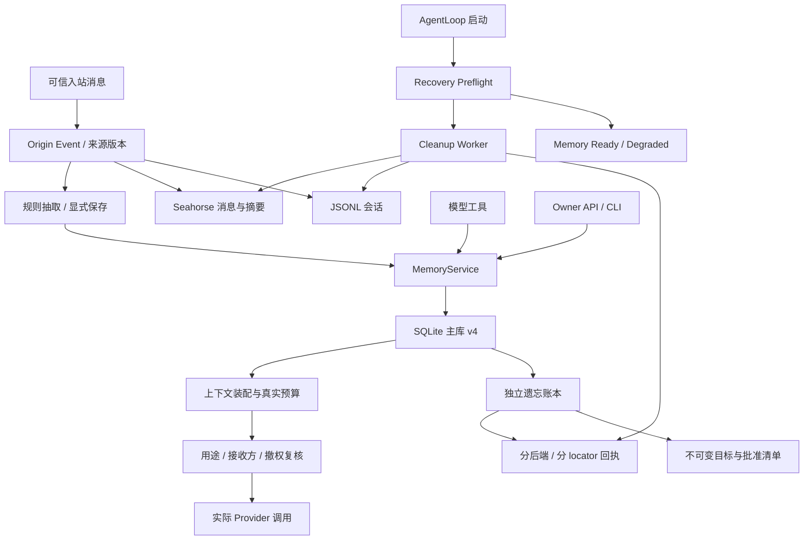

# PicoClaw 记忆系统完整性修复实施计划

> - 文档状态：0.7.25 已实施 A 段主要项；0.7.26 增加一次性升级向导；B/C 与完整 V4 产品能力仍待后续
> - 编制日期：2026-11-28
> - 代码基线：`ad3b710f`（0.7.26 升级向导热修；0.7.25 发布 tag 为 `b9249384`）
> - Schema 基线：主库 Schema v4；不在 `Open` 中自动迁移或自愈业务数据
> - 审计依据：当前源码、根 `AGENTS.md`、V4 实施计划 FR-01—FR-41、0.7.20 整改计划与发布说明、用户提供的只读参考快照
> - 重要边界：计划正文仍是验收设计；已落地范围以 0.7.25 实施记录为准，未列入记录的项目仍按计划待办。本文件不授权修改真实数据库、执行迁移、Replay、Cleanup、提交、打 tag、发布或线上部署

## 0.7.26 一次性升级向导（2026-11-28）

- `/memory` →「数据库修复」新增一次性升级向导：只读预览、owner 确认、强制主库+账本备份、v3→v4（如需要）、默认域恢复、历史 cleanup 结案、恢复门禁复核与 `restart_required` 提示。
- 修复 `runRecoveryPreflight` 错误关闭进程级共享 Store 的问题；迁移后数据库 ready 不再被误当作运行中的 gateway 已恢复，页面要求重启并复查。
- 安全可修的默认域与 orphan entries 自动修复；历史 `cancelled/blocked/failed` cleanup 以 `legacy_closed` 显式结案并记录 `legacy_cleanup_unverified` 审计，不再全局阻塞记忆。
- `legacy_closed` 不表示副本已验证删除；报告保留 `residual_risk` 与备份路径。pending/running cleanup、pending/blocked ledger intent 或未来 Schema 仍拒绝伪完成。
- 参考库副本演练：131 条 orphan entries、缺失默认域、2 条 cancelled cleanup，一次操作后 `ready=true`，2 条结案且主库/账本备份生成。

## 0.7.25 实施记录（2026-11-28）

本节记录 `feat/memory-completeness-0.7.25` 的实际落地范围；计划正文仍是验收设计，不能用本记录替代逐项源码与测试证据。

**已完成**

- Replay：默认只输出 preview；`blocked/unsupported/unapproved` intent 不执行；manifest v2 逐目标记录 domain 与 expected revision，legacy manifest 用 HMAC digest proof；API 需 `confirm=true`，CLI 需 `--yes`。
- Seahorse assembler 懒初始化竞态修复，race 门禁重新验证。
- 群聊/公开聊天只允许 `realm=real`；显式 fictional/work 返回 `ErrRealmNotAllowed`，低层 Store SQL 同样强制交集。
- 旧 workspace 导入改为 CLI-only，HTTP `POST /api/memory/import` 返回 410；导入默认 `private/pending/legacy_unassigned`。
- 独立账本新增 `forget_receipts`（backend + locator）与 `forget_journal.blocked_reason/updated_at`；cleanup 回执支持 missing、`verified_absent`、`outcome_unknown`。
- `cleanup` 在 backlog、blocked、cancelled 或回执不完整时非零；`requeue-job` 创建 successor 并把旧行标记 `superseded`。
- `recovery-status` 与启动预检：存在 pending/blocked intent 或 pending/running/blocked/cancelled cleanup 时长期记忆 fail closed，普通聊天可无记忆运行。
- origin event 已在生产路径接线：入站自动抽取与 `memory` 工具由宿主生成稳定 ID；同一事实多消息保留多 sources；`MarkOriginUnavailable` 只撤回来源、不删除事实。
- 自动抽取改为 `memory_jobs` durable 引用：payload 只保存 source keyed digest、session 与 origin，不保存正文；worker 从持久会话校验原文并写无正文回执。
- 固定块预算：boundary 参与预算，第一条核心规则保留，`FixedUsage` 指标真实赋值并补回归测试。
- owner review/persona/审批写入口统一经 `MemoryService` 审计。
- API 新增 recovery、origin unavailable、job requeue 路由；OpenAPI 更新到 0.7.25。

**仍保持关闭 / 后续**

- `MemoryUseManifest` 未实现，仅有保守依赖与隔离基础。
- 主动投递/发送调度未接通；commitments/recalls 没有真实数据验证。
- 多域 relationship/capsule 继续 fail-closed，未交付。
- 长文分块与时间抽取未接线。
- 外部 LLM 抽取、embedding/向量检索、MMR 保持关闭。
- 来源撤回目前只覆盖主库支持度与依赖摘要失效；跨会话副本、备份与 HMAC 轮换仍属后续。
- 本记录不宣称完整 V4 产品能力已交付，不授权真实迁移、Replay、Cleanup、提交或发布。

## 0. 结论与执行摘要

当前 0.7.20 已落地大部分安全整改，但尚未达到完整验收要求：

1. `blocked` 遗忘意图仍可被通用 Replay 删除，修订冲突保护存在实际旁路。
2. Seahorse assembler 懒初始化存在可重复复现的 data race，0.7.20 的 race 门禁不成立。
3. 群聊可通过显式 `realm` 参数覆盖 fictional 排除。
4. 恢复对账异步启动，不是“恢复核验完成前关闭记忆读写”的前置门禁。
5. 历史 cancelled/blocked cleanup 缺少可执行恢复路径。
6. origin event 生产链路未接通，来源根仍不是完整稳定证据链。
7. owner review/persona 等写入口仍绕开统一审计。
8. 完整 V4 的派生依赖、来源撤回、HMAC 轮换、持久抽取、OpenAPI 和主动投递仍未交付。

建议按以下顺序实施：

```text
M0 冻结基线与失败用例
  ↓
M1 安全止损：Replay、race、realm、危险导入
  ↓
M2 遗忘、恢复与清理状态机
  ↓
M3 证据、权限与治理闭环
  ↓
M4 检索、预算、运行时与接口一致性
  ↓
A 段验收
  ↓
B/C 可选产品能力
```

只有在 M0—M4 全部通过后，才可宣称“可信记忆底座验收通过”。B/C 完成前，不得宣称“完整 V4 产品能力已交付”。

## 1. 目标、范围与完成定义

### 1.1 本轮必须达到

1. `blocked`、修订变化、未批准 intent 不可能被任何 Replay、API、CLI 或后台 worker 执行。
2. 群聊、公开聊天、模型工具、固定注入、检索和胶囊使用一致的 realm、audience、domain 限制。
3. Seahorse 相关数据竞态全部关闭，并可重复通过 race 测试。
4. 遗忘义务在启动、崩溃、重试、主库回滚和任务取消后仍不会静默丢失。
5. 每个清理后端和 locator 都有可恢复状态；无法证明时如实报告 `partial`、`unavailable` 或 `outcome_unknown`。
6. 新写入具有宿主生成的 origin event、来源版本和完整来源根。
7. 所有 owner 写入口经过 `MemoryService`，保存可信 actor、request ID、reason code 和批准关联。
8. 核心 boundary 超预算不会静默丢弃或无限突破；实际 token 账单与最终装配一致。
9. API、CLI、UI、文档对 `accepted`、`blocked`、`partial`、`unknown`、`done` 的描述一致。
10. 参考快照中的历史未知项保持 `unknown`、`legacy` 或 `blocked`，不自动补造来源、批准或删除完成状态。

### 1.2 本轮不作为 A 段前置

- 外部 LLM 抽取。
- embedding、向量检索、MRR/MMR。
- 主动消息实际投递。
- 完整多域 relationship/capsule。
- 每 Agent 独立 Seahorse Engine。
- 高质量自动阶段理解与自动时间抽取。

这些能力可以保持关闭，但配置和 UI 必须明确标记“未接线”或“保留项”，不能让用户误以为开关已生效。

### 1.3 完整性声明规则

| 完成范围 | 允许声明 |
|---|---|
| M0—M1 | 已关闭已复现的紧急安全缺陷 |
| M0—M2 | 遗忘与恢复闭环达到本轮整改目标 |
| M0—M4 | 可信记忆底座验收通过 |
| B/C 阶段完成 | 长期理解与可控主动能力交付 |
| G7/G8 验证通过并启用 | 可选增强交付 |

- 不使用缺乏统一权重的“完成百分比”。
- 不以“表和字段已存在”代替“入口、失败和恢复语义已接通”。
- 不以普通测试通过代替 race、故障注入和真实副本演练。

## 2. 非目标与硬约束

### 2.1 非目标

- 不恢复 v1→v2→v3 旧迁移链。
- 不在 `Open`/启动路径自动迁移或自愈业务 Schema。
- 不把 `MEMORY.md`、每日笔记重新引入运行时事实源。
- 不建立新的 service/repository 抽象层；继续使用现有 `MemoryService`。
- 不引入新的向量数据库、外部摘要模型或通用任务平台。
- 不承诺物理介质彻底擦除、撤回已发送至第三方的内容或精确一次跨平台投递。
- 不为一次修复顺手重构无关模块或批量格式化历史文件。

### 2.2 安全与数据硬约束

- 不硬编码密钥、密码、token。
- 不提交 `.env`、`*.db`、`forget-ledger.db`、私密 workspace。
- 记忆正文、原始查询、证据原文和秘密不得进入日志、指标、错误消息、测试报告或发布产物。
- 不访问或修改真实用户数据库，除非用户明确授权并说明范围；验证优先使用临时副本或合成 fixture。
- 维护写入必须遵循：预检 → 备份主库与账本 → 事务修改 → 最终复检。
- 两个 SQLite 库没有共同原子事务，不得把账本 `MarkApplied` 与主库删除写成同一事务。
- 旧数据无法证明归属、来源或完成状态时，保持 unknown/legacy/partial，不猜测补齐。
- 读取许可不等于外发许可；模型参数只能缩小权限，不能扩大 domain、realm、audience 或接收方。
- 数据库结构、鉴权语义、公共 API 签名和发布流程变更必须单独确认并提供回滚方案。

## 3. 目标结构



架构约束：

- 主库继续保持 Schema v4。
- 账本负责删除义务与恢复证据；主库 job 只是可重建执行投影。
- 普通聊天在记忆恢复失败时可降级为“不使用长期记忆”，但不能继续使用旧记忆快照。
- 所有读取与写入以可信请求上下文为边界，不把 Store 管理方法直接暴露给模型或普通 API。

## 4. 关键设计决策

### ADR-01：blocked intent 永不进入通用 Replay

**决定**

- `ReplayForget` 不再直接遍历并执行 `AllIntents`。
- `AllIntents` 只用于审计。
- 执行入口只选择符合状态、批准、域和修订条件的 intent。
- `blocked` 不原地改成 `pending`，而是通过新预览生成新的 request ID 和后继维护动作。
- 旧 blocked 记录永久保留用于审计。

**理由**

原地解锁会丢失冲突历史，也容易让旧批准覆盖新正文。

**代价**

需要增加 successor 关联和 UI 操作，但能避免“旧批准无限有效”。

### ADR-02：Seahorse 改为构造期初始化

**决定**

优先在 `NewEngine` 中直接初始化 assembler 和 compaction，删除不必要的懒初始化双检路径；不引入新的并发框架。

**理由**

两者都是轻量对象，构造期初始化比修复多层双检更简单，也能统一 `Close` 生命周期。

**代价**

每个 Engine 都会分配两个轻量结构；实施前需确认不存在依赖“nil assembler/compaction”这一内部状态的外部测试或代码。

### ADR-03：realm 权限采用交集，不用参数覆盖默认拒绝

**决定**

- Service 对群聊/公开聊天拒绝不兼容的显式 realm。
- Store SQL 同时应用“上下文允许 realm”和“调用方请求 realm”，两者是交集。
- 防御逻辑不能只放在工具或 UI。

**理由**

模型参数只能缩小权限，不能覆盖宿主上下文。

### ADR-04：恢复门禁先于记忆读写，晚于普通聊天可用性

**决定**

启动时同步执行恢复预检：

1. Schema、账本、HMAC 身份和水位检查。
2. 默认域及引用一致性检查。
3. pending、blocked、inert 删除义务分类。
4. 可安全恢复的 intent 先对账。
5. 设置 `ready`、`degraded` 或 `blocked` 状态。
6. 状态明确后才开放对应域的记忆读写。

存在无法自动恢复的历史义务时，普通聊天可继续，但必须使用无长期记忆上下文。

### ADR-05：清理回执保存在独立账本，主库不升 v5

**决定**

主库 Schema 保持 v4；在独立账本中增加内部版本化回执结构，建议表为：

```text
forget_receipts
- ledger_uuid
- intent_seq
- request_id
- backend
- locator_digest
- backend_generation
- state
- attempt
- reason_code
- updated_at
```

状态至少包括：

```text
pending / running / removed / verified_absent /
unavailable / outcome_unknown / blocked
```

不保存正文、证据原文或可读敏感主题。

**为什么不用主库 job payload 代替**

主库回滚会同时丢失回执，无法区分“后端已删除”和“从未执行”。

**审批边界**

这是独立账本的结构变更，实施前仍需单独确认；必须先备份账本，并验证旧账本只读兼容。

### ADR-06：新证据必须宿主生成，旧证据不自动补造

**决定**

- origin event 在可信入站边界生成并持久化。
- 根证据覆盖完整来源单元，而不是默认使用模型传入的“新记忆正文”。
- `evidence_text` 继续作为展示摘要，不再冒充完整证据。
- 旧数据无 origin/root 时标为 `legacy_unbound` 或 `unavailable`。
- 只有可验证来源与 owner 明确操作才能重新绑定。

### ADR-07：保持主流程轻量，把可选增强隔离在 A 段之后

**决定**

- A 段先解决权限、恢复、来源和预算正确性。
- LLM 抽取、向量和主动投递只有独立开关、外发许可、成本上限和盲测收益后才可启用。
- 不为“未来可能扩展”预建通用工作流或语义平台。

## 5. 问题到工作包的追踪矩阵

| 审计问题 | 工作包 | 验收重点 |
|---|---|---|
| blocked intent 可被 Replay 删除 | WP-01 | 零删除、零 Provider、状态不被伪装 |
| Replay 无服务端 dry-run | WP-01、WP-17 | API/CLI 默认预览 |
| Seahorse assembler race | WP-02 | 重复 `-race` 通过 |
| 群聊可显式查询 fictional | WP-03 | Service + SQL 双层交集 |
| 任意本地路径导入且默认 audience=all | WP-04 | Web 禁任意路径，默认隔离 |
| 恢复对账后台启动、读写未关闭 | WP-07 | 启动 readiness gate |
| cancelled/blocked 任务无恢复 | WP-05、WP-08 | 新预览生成 successor |
| outcome_unknown 无真实赋值 | WP-06 | 分后端持久回执 |
| origin event 未生产接线 | WP-09 | 入站生成、持久映射 |
| 多消息来源被空 origin 折叠 | WP-10 | 多来源幂等独立保留 |
| 来源编辑/撤回未实现 | WP-11 | 支持状态与摘要失效 |
| 默认域行缺失未被发现 | WP-12 | 显式完整性计划 |
| owner review/persona 绕过审计 | WP-13 | 统一 service + actor/request |
| 预算溢出字段未赋值 | WP-14 | 实际 usage 与硬上限 |
| LIKE 通配符未转义 | WP-14 | `%`、`_` 负例 |
| 自动抽取非持久任务、无回执 | WP-15 | job、回执、租约、背压 |
| 派生历史无 MemoryUseManifest | WP-15 | 保守依赖与隔离 |
| retry/subagent/其他 Provider 漏检 | WP-16 | 实际接收方矩阵 |
| 前后端状态和 OpenAPI 缺失 | WP-17 | 契约校验与 UI smoke |
| AGENTS/guides 文档漂移 | WP-18 | 文档与实现一致 |
| 参考快照历史未知数据 | 第 8 节 | 只读报告、不自动补造 |

## 6. 分阶段实施

### M0：冻结基线与建立失败用例

#### 工作项

1. 固定当前 HEAD、0.7.20 tag 和参考快照统计。
2. 把已确认的合成负例转为正式回归测试：
   - blocked intent 经 Replay 删除目标。
   - 群聊显式 fictional 返回 public fictional 条目。
3. 保留并稳定复现 `TestAssemblerLazyInitRace`。
4. 建立恢复、来源、审计和预算的失败用例。
5. 建立不含正文的测试观测输出。

#### 主要文件

- `pkg/memstore/governance_test.go`
- `pkg/memstore/g3_recovery_test.go`
- `pkg/memstore/hardening_test.go`
- `pkg/seahorse/short_engine_test.go`
- `web/backend/api/memory_test.go`
- `cmd/picoclaw/internal/memory/command_test.go`

#### 完成门禁

- 每个已确认缺陷都有“修复前失败”的证据。
- 测试断言最终数据库状态、Provider 调用次数和外部副本状态，不只检查返回值。
- 不访问或修改参考库原件。

### M1：安全止损

#### WP-01：Replay 与审批闭环

**代码范围**

- `pkg/memstore/governance.go`
- `pkg/memstore/ledger.go`
- `pkg/memstore/reconcile.go`
- `pkg/memstore/service.go`
- `web/backend/api/memory.go`
- `cmd/picoclaw/internal/memory/command.go`

**实施内容**

1. 将 Replay 分为：
   - `PreviewReplay`
   - `ExecuteReplay`
   - `ReconcilePendingIntents`
2. 三个入口共用同一套资格校验，不能各写一套状态判断。
3. 目标清单升级为版本化结构，逐项保存：
   - entry ID
   - domain
   - expected revision
   - namespace
   - 批准/request 关联
4. 兼容旧 `entry_ids` 清单只用于预览和报告，不自动删除仍存在的目标。
5. 执行时按 Store 锁内事务重新校验：
   - intent 状态；
   - domain/namespace；
   - 每个目标 revision；
   - actor/批准上下文；
   - payload digest。
6. 多目标中任一冲突，整批零修改。
7. 目标已不存在时，只允许恢复清理投影，不虚构主库删除数量。
8. `MarkApplied/MarkBlocked` 检查实际影响行数与合法状态迁移。
9. Web Replay 默认 dry-run；真实执行要求 owner、confirm 和新预览。
10. CLI 与 Web 返回一致的冲突、待批准和清理状态。

**回归测试**

- pending/applied/blocked/unapproved 四状态矩阵。
- blocked Replay 必须零删除。
- 修订变化后 Replay 必须冲突。
- 多目标部分冲突时整批回滚。
- API 与 CLI 默认 dry-run。
- worker 与 owner Replay 并发时只能有一个执行者。
- 重放成功后重复请求保持幂等。

#### WP-02：Seahorse 并发修复

**实施内容**

- 构造期初始化 assembler/compaction。
- 删除不再需要的双检字段和函数。
- 核对 `Close` 与异步 condensed compaction 的生命周期。
- 不顺便重写 Seahorse 存储层。

**验证**

```sh
CGO_ENABLED=1 go test -race -tags 'goolm stdjson' \
  ./pkg/seahorse -count=10 -timeout=600s
```

同时执行 memstore、memory、agent 的 race；不能因一次未报 race 就宣称并发安全。

#### WP-03：realm/audience/domain 隔离

**实施内容**

- 在 Service 和 SQL 两层执行 realm 交集。
- 覆盖 Search、FTS、LIKE、anchor、时间、1-hop、固定块和 capsule。
- 工具传 `fictional`/`work` 不得扩大群聊权限。
- 对显式越权 realm 返回可识别错误，而不是伪装成普通“无结果”。
- 保留 private 的独立阻断。

**验证矩阵**

| 调用上下文 | real | work | fictional public | fictional private |
|---|---|---|---|---|
| 私聊 | 按配置 | 按配置 | 按配置 | 允许授权项 |
| 群聊 | 仅授权 public | 按最终契约拒绝/限制 | 拒绝 | 拒绝 |
| 公开聊天 | 仅授权 public | 按最终契约拒绝/限制 | 拒绝 | 拒绝 |
| 缺 ChatKind | fail-closed | fail-closed | 拒绝 | 拒绝 |
| 管理入口 | 显式管理员语义 | 同左 | 同左 | 同左 |

#### WP-04：立即收紧危险导入口

**实施内容**

- Web 不再接受任意宿主机 workspace 路径。
- 实际旧工作区导入保留为显式 CLI 维护动作。
- 导入默认：
  - `domain_id=legacy_unassigned`
  - `audience=private`
  - 审核/隔离状态
  - 不伪造用户确认
- 所有导入经 `MemoryService`，保存 owner actor 和 request ID。
- 导入前检查所有有效墓碑。
- 返回 added/skipped/blocked/conflict 数量，不把跳过当成功。

#### M1 放行条件

- 三个已复现缺陷全部关闭。
- 普通测试、race、API/CLI 负例全部通过。
- 未完成 M2 前，不宣称“完整遗忘恢复已验收”。

### M2：遗忘、恢复与清理闭环

#### WP-05：统一任务状态机

**建议状态**

```text
pending
running
failed_retryable
blocked
outcome_unknown
done
```

约束：

- `forget_cleanup` 不允许通过普通 cancel 删除义务。
- 历史 `cancelled` 映射为“需要人工复核的 inert/blocked”，不自动重新执行。
- 暂时性后端错误采用有界指数退避。
- 无来源根、定位不符等永久问题直接 blocked。
- 达到重试上限只转 blocked，不删除账本义务。
- blocked 的人工处理通过新预览、新 request、新任务完成，旧任务保持审计记录。

#### WP-06：分后端、分 locator 持久回执

**改造点**

- `MessageCleaner` 返回逐项结果，而非只有聚合计数。
- `compositeCleaner` 保留 backend 身份，不能把 JSONL 与 Seahorse 混成一个无归属结果。
- 每项执行前后更新独立账本回执。
- 主库 job 记录账本引用和执行投影，不作为唯一恢复依据。
- `done` 必须表示所有选定范围均已达到可验证终态。
- `verified_absent` 只说明“当前可验证不存在”，不声称知道是本次删除还是从未存在。
- 运行中崩溃且缺回执的 locator 进入 `outcome_unknown`，随后通过只读核验恢复，不盲目报告 removed。

#### WP-07：恢复预检和水位

**实施内容**

- 新增内部 `RecoveryPreflight`，不新增服务层。
- 检查：
  - Schema 与迁移状态；
  - 账本 UUID、namespace、key ID；
  - active/backup max seq 和 applied seq；
  - pending、blocked、inert job；
  - 后端恢复代际；
  - 默认域与引用一致性。
- 主库恢复后，从账本重建缺失 cleanup 投影。
- 已存在 cancelled/blocked 任务时不得被 `INSERT OR IGNORE` 静默跳过而不报告。
- 旧账本不得覆盖更新账本。

#### WP-08：CLI/API/UI 真实反馈

- `memory cleanup` 在存在未处理 blocked/inert/unknown 或仍有余量外积压时返回非零。
- API 返回每后端聚合计数、原因码和 request ID。
- UI 区分：
  - accepted
  - running
  - partial
  - blocked
  - outcome_unknown
  - verified_absent
  - done
- “重新排队”按钮必须先打开新预览，不直接修改数据库状态。

**M2 故障注入**

1. 账本提交前崩溃。
2. 账本提交后、主库提交前崩溃。
3. 主库提交后、cleanup 入队可见前恢复。
4. JSONL 已删、回执未写。
5. Seahorse 已删、回执未写。
6. 一个后端成功、另一个 unavailable。
7. 回执写盘失败。
8. 磁盘满、队列满、租约过期、重试耗尽。
9. 主库/outbox 回滚，账本保持最新。
10. 账本或 HMAC 身份缺失/损坏。

### M3：证据、权限与治理闭环

#### WP-09：Origin Event 生产接线

**入站流程**

1. 优先使用渠道、账号、会话和原生消息 ID 形成稳定身份。
2. 无原生 ID 时由宿主持久生成 UUID。
3. 同一消息重放保持相同 event ID。
4. 编辑增加 `origin_revision`，不能覆盖旧版本。
5. JSONL 与 Seahorse 的内部 ID 通过映射关联，不假定两者共用 ID。

**代码落点**

- 入站 pipeline 和 `turnState`
- `pkg/agent/memory_runtime.go`
- `pkg/memstore/extract.go`
- `pkg/memory/jsonl.go`
- `pkg/seahorse/short_engine.go`
- `pkg/memstore/store.go`

**兼容策略**

- Seahorse 优先为现有 `IngestResult` 增加可选定位字段，避免直接修改既有方法签名。
- JSONL 使用现有 metadata；若确需新增可选字段，必须验证旧文件仍可读取。
- 不自动扫描用户任意目录来补建 origin。

#### WP-10：完整来源根与多来源幂等

**根协议**

- `jsonl.content`：完整 Content。
- 工具参数：使用版本化、规范化的完整参数单元，避免仅对模型新生成正文求根。
- Seahorse：明确 message/part 类型与完整 part 内容。
- 未接入的媒体、外部文件不伪造清理能力。

**写入规则**

- 一个 origin event 对应一个根。
- 同一事实的不同消息形成不同 sources。
- 同一 origin 重试才幂等忽略。
- `EvidenceText` 仍可有 120 rune 展示截断，但根在截断前计算。
- `ForgetTargetManifest.OriginEventIDs` 实际填充。
- 清理先验证来源定位，再执行删除。

#### WP-11：来源编辑、撤回和不可用

实现最小闭环：

- `MarkOriginUnavailable` / 来源版本更新入口。
- 重新计算 entry 的支持状态。
- 使相关摘要和胶囊失效。
- 有其他合法来源时保留事实，但降低或重算支持关系。
- 无独立来源时标记 `unsupported`/待复核，不自动断言事实为假。
- 来源撤回不自动扩大为整条事实遗忘。
- 渠道不支持通知时，文档明确“不能实时同步”。

#### WP-12：默认域与身份授权

- 将默认域行及 entries 引用纳入显式完整性计划。
- `Open` 发现缺失时故障关闭，不自动补行。
- 显式 repair 在备份后创建已知的 `legacy_unassigned` 行，不猜测 owner。
- 未使用的 `dom_main` 不自动删除或接管。
- actor binding、processing grant 没有生产接线前，文档标为保留基础设施。
- 非 legacy 多域继续 fail-closed，另提 RFC，不用拼接上下文伪造多域授权。

#### WP-13：统一 owner 写入与审计

将以下入口全部转入现有 `MemoryService`：

- archive/restore
- review approve/archive/merge
- persona 新增、修改、激活
- import
- relationship/persona 管理写
- change plan 执行与恢复

每次写入必须具有：

```text
actor
request_id
reason_code
policy_revision
approval / plan 关联（适用时）
```

同时：

- 状态变化递增 entry `row_revision`。
- pinned/core 的状态、受众和正文变更都复核批准。
- review merge 必须保留目标关系和来源，不只是把一个状态改为 superseded。
- plan 的 failed terminal、retryable、unknown、blocked 语义与任务状态一致。

### M4：检索、预算、运行时与接口一致性

#### WP-14：预算与检索修正

1. 使用同一 renderer/token 估算路径计算最终文本。
2. `OverflowTokens/CoreOverflow/BoundaryCut` 真实赋值并向上传递。
3. 单条核心 boundary 超硬上限时返回明确装配错误，Provider 调用必须为 0。
4. 非核心内容先裁剪，核心规则不静默丢弃。
5. `EstimateSystemTokens` 使用实际装配结果，不再直接加入整份配置预算。
6. LIKE 转义 `%`、`_`，避免用户通配符扩大匹配。
7. 明确 anchor 最近 800 条是有界扫描，不宣称全量召回。
8. capsule 的过滤位置与文档保持一致。
9. 管理 inspect/export 可以查看历史/过期数据，但必须明确是管理语义；运行时读取默认排除过期。
10. 时间查询补可控时钟；三模式、IANA 时区和历史有效版本作为后续独立验收项。

#### WP-15：自动抽取和派生内容治理

- 将自动抽取从裸 goroutine 演进到现有持久 job。
- 保存来源引用、attempts、租约、错误码和退避。
- 返回 `added/merged/pending_review/blocked/skipped/failed` 回执。
- 子代理系统提示、工具内部轮次不得自动学习。
- 自动抽取同时遵守 ChatKind 和 `private_channel_exclusions`。
- 关闭采集后旧任务不能提交。
- 使用现有 `memory_dependencies`/消息 metadata 实现保守 `MemoryUseManifest`：
  - entry/source/revision
  - domain/namespace
  - policy/binding revision
  - 使用目的
- 无法证明细粒度依赖时，隔离整个相关轮次或摘要，不做字符串替换式“精确脱敏”。

#### WP-16：发送点补测

保留现有主路径检查，并补：

- legacy 摘要每次 retry 前重新检查。
- subagent 使用实际目标 Agent、Provider 和 model，而非父 Agent 首候选。
- Seahorse 缺可信 session 时不得默认落到 default Agent。
- 对 audio/evolution 等其他 Provider 调用做数据流分类：
  - 不接触记忆：记录理由；
  - 可能接触记忆或其派生内容：接入同一 egress。
- 撤权后阻断迟到结果回写和旧快照复用。
- 空 recipients 继续兼容时，在 UI 和启动警告中明确“兼容放行”；严格默认拒绝另做配置迁移。

#### WP-17：API、CLI、UI、OpenAPI 与配置

- 编写并校验 `memory-v4.openapi.yaml`。
- 新错误采用统一 problem details；区分 400/403/404/409/422/503。
- 异步遗忘返回 202 和可追踪 request/job 信息。
- 新列表采用统一 cursor/limit；旧路由保留明确兼容策略。
- 配置显示 saved/effective/apply 状态。
- 未接线 V4 开关禁用并标注，不再返回“已生效”假象。
- 临时无记忆会话从干净上下文开始，与“暂停采集”“不保存历史”分开表达。
- 不新增前端测试框架；使用 Go `httptest`、现有前端构建及浏览器人工 smoke。

#### WP-18：文档纠偏

- 修正根 `AGENTS.md` 的 0.7.2 混合基线、失效第 4.9 节引用和损坏残片。
- V4 历史计划明确“历史设计”，不再把 M4/M5/M6 写成当前迁移路径。
- 修正 guides 中：
  - boundary 不参与裁剪的错误描述；
  - origin event 已隔离的错误描述；
  - blocked 可重排但代码无入口的描述；
  - capsule/TTL/overflow 的不准确描述。
- 0.7.20 的历史验证记录保留，并增加“后续复测发现 race/治理旁路”的勘误；不能改写成当时已经发现。
- 新版本的发布说明只记录实际重新执行并通过的命令。

## 7. 参考快照的专项处置

以下均先在临时副本上演练，不对参考库原件执行写操作。

### 7.1 当前只读统计

| 指标 | 审计快照结果 |
|---|---:|
| Schema / revision | v4 / 4294 |
| entries | 131：123 active、8 superseded |
| 主库与账本完整性 | 均 `ok`，无外键异常 |
| active 精确重复组 | 0 |
| entries / FTS 行数 | 131 / 131 |
| sources | 131，每条 entry 恰好一个来源 |
| `origin_event_id` 非空 | 0 / 131 |
| `evidence_root` | 14 条有、117 条无 |
| `memory_origin_events` | 0 行 |
| message/model/prompt/确认事件 | 来源记录中均为空 |
| forget 操作 | 179 次 |
| 有对应账本 intent | 2 次 |
| 无账本历史 forget | 177 次 |
| cleanup job | 2 条，均为 `cancelled` |
| actor bindings / processing grants | 0 / 0 |
| active 的 event_at | 123 条全部为空 |
| commitments / recalls | 0 / 0 |

### 7.2 默认域异常

现状：

- entries 全部 `legacy_unassigned`；
- `memory_domains` 只有 `dom_main`；
- 缺少默认域行。

处理：

1. 只读预检列出引用差异。
2. 备份主库和账本。
3. 显式维护中只创建已知默认域行，不设置猜测 owner。
4. 保留 `dom_main` 原状。
5. 复检所有 entry domain 引用。
6. 第二次执行必须零变更。

### 7.3 两条 cancelled cleanup

处理：

1. 标记为历史 inert/blocked，不直接 SQL 改回 pending。
2. 检查现有账本、manifest、locator 和当前副本是否仍可验证。
3. owner 新预览后创建 successor request/job。
4. 清理完成后分别保存 JSONL/Seahorse 回执。
5. 如果目录仍缺 JSONL/Seahorse，则结果只能是 unavailable，不得返回全部完成。

### 7.4 177 次无账本历史 forget

- 继续只读审计。
- 不把无盐 hash 转成 HMAC。
- 不自动批量删除当前条目。
- 只有 owner 在恢复副本中对明确目标重新创建维护删除，才生成新的 actor/request/账本记录。
- 新动作不能冒充历史批准。

### 7.5 来源与时间字段

- 117 条无 root：保持 legacy/unavailable。
- 14 条有 root 但无 origin：标为 root-unbound，不能宣称完整证据链。
- 所有空 event 时间：不根据 `created_at` 自动补事件时间。
- 空 model/prompt/actor：保持未知，不按当前版本倒推历史身份。

### 7.6 长文和产品能力

- active 正文长度中位数约 3412 字节，117/123 超过 1 KiB，48/123 超过 4 KiB。
- 长文治理有真实需求，但不能仅凭长度断言检索质量差。
- 当前 14 个手工簇、18 个摘要版本，不等于完整自动主题理解。
- commitments/recalls 为 0，主动投递没有真实数据验证。
- 提供的目录没有 JSONL、Seahorse 和恢复备份，因此不能证明外部副本已清理或恢复闭环可用。
- 如果下载库仅作参考副本，其 `0644` 权限不代表线上状态；若直接作为运行库，则不符合项目要求的 `0600`。

## 8. 测试矩阵与发布门禁

### 8.1 对抗测试

| 编号 | 场景 | 必须断言 |
|---|---|---|
| T01 | blocked intent Replay | 删除 0、Provider 0、状态不被伪装 applied |
| T02 | 修订变化/多目标冲突 | 整批零修改 |
| T03 | API/CLI Replay | 默认预览，真实执行需 owner 和新批准 |
| T04 | Seahorse 并发初始化/Close | 重复 race 无报告 |
| T05 | 群聊显式 fictional/work | 不返回越界条目 |
| T06 | legacy 导入 | 默认隔离、private、墓碑有效 |
| T07 | 启动存在 pending/blocked | 受影响记忆读写关闭，清理仍可运行 |
| T08 | cancelled/inert cleanup | 可见、非零状态、可经新预览恢复 |
| T09 | 后端删除后回执前崩溃 | outcome_unknown，不报假成功 |
| T10 | 单后端 partial | 另一后端成功不能掩盖失败 |
| T11 | 多消息支持同一事实 | 多来源分别保留，重试幂等 |
| T12 | 长消息/完整工具参数 | 根可验证，120 rune 不参与假匹配 |
| T13 | 来源编辑/撤回 | 支持状态和摘要正确失效 |
| T14 | 默认域缺失 | Open 故障关闭，显式修复幂等 |
| T15 | owner review/persona/import | actor/request/批准审计完整 |
| T16 | 单条超长核心 boundary | 明确溢出，Provider 调用 0 |
| T17 | 撤权/fallback/subagent/retry | 不改投、不复用旧快照 |
| T18 | 磁盘满/队列满/重试耗尽 | 删除义务不丢、不假成功 |
| T19 | 主库回滚+最新账本 | 可重建清理，不复活正文 |
| T20 | 旧配置/旧 JSONL/旧账本 | 兼容或明确拒绝，不静默改写 |

### 8.2 最终验证命令

实施后按影响执行，不以历史结果代替：

```sh
go build -tags 'goolm stdjson' ./...

go test -tags 'goolm stdjson' ./... \
  -count=1 -timeout=600s

CGO_ENABLED=1 go test -race -tags 'goolm stdjson' \
  ./pkg/memstore ./pkg/memory ./pkg/seahorse ./pkg/agent \
  -count=1 -timeout=600s

CGO_ENABLED=1 go test -race -tags 'goolm stdjson' \
  ./pkg/seahorse -count=10 -timeout=600s
```

前端：

```sh
cd web/frontend
pnpm run lint
pnpm run build
```

另需单独完成：

- 临时目录中的完整备份、恢复和故障注入。
- 浏览器覆盖迁移、遗忘、Replay、blocked、任务状态和设置生效状态。
- 文档链接、命令和中英文一致性检查。
- 不含正文、原始查询、密钥和私密路径的日志审查。

### 8.3 发布门禁

出现任一情况不得发布：

- blocked intent 可被任何入口执行。
- 修订冲突未阻止删除。
- 任一 race 失败。
- 群聊可读取不允许的 realm 或 private。
- 清理无法区分 partial/unknown 却报告 done。
- 恢复前已开放受影响记忆读写。
- 旧配置因字段删除或部分 PUT 失效。
- 维护路径先改库后备份。
- 文档宣称不存在的能力或未执行的验证。

## 9. 提交、回滚与发布边界

### 9.1 推荐提交批次

获得实施授权后，按以下小批提交：

1. `test:` 固定 Replay、realm、race 失败基线。
2. `fix(memstore):` 关闭 blocked/revision Replay 旁路。
3. `fix(seahorse):` 构造期初始化并修复生命周期竞态。
4. `fix(memory):` 群聊 realm 交集与导入默认隔离。
5. `feat(memstore):` 任务状态机、恢复预检和持久回执。
6. `feat(memory):` origin event、完整来源根和多来源幂等。
7. `fix(agent):` 抽取、派生依赖、预算与剩余发送点。
8. `fix(api):` owner 审计、Replay/任务/OpenAPI 契约。
9. `docs:` 指南、设计状态、恢复手册和真实验证结果。

每批只提交对应文件，不混入无关格式化或用户已有改动。

### 9.2 回滚原则

- Replay 修复异常时优先禁用真实 Replay，只保留预览，不回退到可执行 blocked 的旧代码。
- 账本结构变更前必须有独立备份；优先向前修复，不用旧账本覆盖新账本。
- 新增 origin metadata 必须保持旧文件可读。
- 安全修复版本出现部署问题时可以停止服务回滚排障，但不能把恢复旧漏洞行为当作长期方案。
- 不自动 force push、移动 tag 或修改历史 Release。

### 9.3 发布边界

只有另行收到明确发布请求后才：

- 确定新版本号；
- 更新 `CHANGELOG.md` 和中文发布说明；
- 打 annotated tag；
- push；
- 触发 Release workflow。

本计划本身不授权版本发布、真实数据迁移或线上操作。

## 10. A 段之后

A 段通过后单独规划，不混入本次安全修复：

1. **B 段长期理解**：自动主题建议、阶段摘要、共同经历时间线、证据展开和删除竞态。
2. **C 段可控主动**：承诺/纪念日、私密订阅、静默时段、限频、发送前复核和 unknown 投递处理。
3. **G7/G8 可选增强**：只有在匿名/合成盲测证明收益、独立接收方许可和遗忘同步成立后才启用。

## 11. 评审记录模板

实施前评审需逐项回答：

| 问题 | 记录 |
|---|---|
| 是否确认只修 M0—M4，不扩张到 B/C | 待确认 |
| 是否批准独立账本增加 receipt 结构 | 待确认 |
| 是否批准公共 API / CLI 行为变更 | 待确认 |
| 是否批准进入真实副本迁移演练 | 待确认 |
| 是否批准提交 / 推送 / 发布 | 待确认 |
| 回滚点和数据备份是否明确 | 待确认 |
| 计划评审是否仍有 BLOCK 项 | 待确认 |

**最终完成定义：所有声明支持的入口，在权限、恢复、失败和并发条件下都有一致、可复现的最终状态证据；不以表、字段、配置项或计划文档的存在代替真实验收。**
